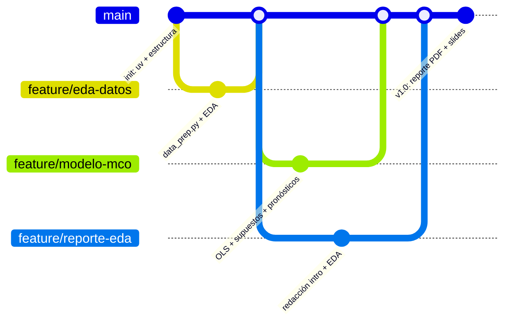

# Plan de Proyecto Final — Análisis de Regresión y Correlación (ARC)

## Objetivo y Contexto

Desarrollar el proyecto final de la materia **Análisis de Regresión y Correlación (ARC)** en equipo de 2 personas (**Richie** y **Mariana**), utilizando el dataset clínico **HYPERAKTIV** (Hicks et al., 2021) mediante **Regresión Lineal Múltiple por Mínimos Cuadrados Ordinarios (MCO)** para modelar la severidad de síntomas de TDAH en adultos (`ASRS`, escala continua 0–72) a partir de biomarcadores de actigrafía, desempeño en la prueba neuropsicológica `CPT-II` y covariables clínicas.

El proyecto se gestionará con **`uv`** (ya instalado: `uv 0.13.5`) y un repositorio colaborativo en **GitHub**, cumpliendo con las fechas oficiales de entrega:
* **Jueves 19 de noviembre:** Registro de equipo y base de datos seleccionada con el profesor.
* **Miércoles 25 de noviembre (11:59 p.m.):** Entrega del reporte final en PDF en Classroom.
* **Jueves 26 de noviembre:** Exposición oral (12–15 min).

---

## User Review Required

> [!IMPORTANT] Decisión de Ubicación: NO trabajar dentro de `MyAwesomeVault`
> Se recomienda crear el proyecto **fuera de `MyAwesomeVault`**, en `/home/richie/Documents/GitHub/ARC_project` (junto a `MLS_project`), por las siguientes razones técnicas:
> 1. **Aislamiento de Git:** `MyAwesomeVault` ya es un repositorio Git personal (`git@github.com:a1252765/MyAwesomeVault.git`). Anidar otro repositorio dentro genera conflictos de submódulos/carpetas ignoradas y dificulta la colaboración con Mariana en GitHub.
> 2. **Aislamiento de `uv` y dependencias:** `MyAwesomeVault` tiene su propio `pyproject.toml`, `uv.lock` y `.venv`. Un repositorio independiente garantiza un entorno reproducible limpio para ti y para Mariana.
> 3. **Privacidad y limpieza:** Evita mezclar notas personales, archivos de trabajo (`04_Trabajo_Drupa`) o configuración de Obsidian con el código del equipo.
> 4. **Vinculación opcional:** Desde `MyAwesomeVault/02_Universidad/Semestre_05/ARC - Análisis de Regresión/` puedes mantener una nota con el enlace al repositorio de GitHub o notas personales de estudio.

> [!NOTE] Datos locales vs. GitHub
> Los archivos crudos de HYPERAKTIV están en `/home/richie/Documents/datasets/adhd/hyperaktiv/`. Como `activity_data/` y `hrv_data/` son pesados y tienen licencia CC BY-NC 4.0, para este proyecto de regresión múltiple solo necesitamos los 3 CSV tabulares (`patient_info.csv`, `features.csv` y `CPT_II_ConnersContinuousPerformanceTest.csv`, ~1.9 MB en total). Se recomienda **no subir `activity_data/` ni `hrv_data/`** a GitHub y definir claramente en `.gitignore` qué se versiona.

---

## Open Questions

> [!IMPORTANT] Decisiones pendientes antes de inicializar el repositorio
> 1. **Nombre del repositorio:** ¿Te parece bien `/home/richie/Documents/GitHub/ARC_project` (siguiendo la convención de `MLS_project`), o prefieres otro nombre como `arc-hyperaktiv`?
> 2. **Sistema operativo de Mariana:** ¿Mariana trabaja en Windows, macOS o Linux? (Para incluir instrucciones exactas de instalación de `uv` y activación en el `README.md`, además de mantener `pyproject.toml` multiplataforma).
> 3. **Formato del reporte PDF:** ¿Prefieren redactar el reporte final en **LaTeX / Quarto** (ideal para ecuaciones matemáticas y tablas automáticas) o en **Google Docs / Word** exportado a PDF?
> 4. **Versionado de los 3 CSV tabulares (~1.9 MB):** ¿Desean incluir los 3 CSV tabulares en `data/raw/` dentro del repo privado de GitHub para que Mariana haga `git clone` y pueda correr todo de inmediato, o prefieren compartirlos por Drive/Classroom y dejar `data/` en `.gitignore`?

---

## Proposed Changes (Arquitectura y Flujo de Trabajo)

### 1. Estructura del Repositorio (`ARC_project`)

Siguiendo las mejores prácticas de `uv` y tomando como referencia la organización de `MLS_project`:

```text
ARC_project/
├── .gitignore                 # Ignora .venv/, __pycache__/, .ipynb_checkpoints/, datos pesados
├── .python-version            # Fijado a 3.13 (o 3.12 para máxima compatibilidad)
├── pyproject.toml             # Dependencias manejadas con uv
├── uv.lock                    # Lockfile reproducible para ambos integrantes
├── README.md                  # Guía de setup con uv, flujo Git y resumen del proyecto
├── data/
│   ├── raw/                   # patient_info.csv, features.csv, CPT_II_ConnersContinuousPerformanceTest.csv
│   └── processed/             # hyperaktiv_arc_clean.csv (dataset integrado listo para MCO)
├── src/
│   └── arc_project/
│       ├── __init__.py
│       ├── data_prep.py       # Carga, filtro (Raw Score Omissions < 300), inner join por ID y limpieza
│       ├── eda.py             # Correlaciones de Pearson, scatterplots, pairplots y cálculo de VIF
│       ├── modeling.py        # Ajuste MCO (statsmodels OLS), transformaciones, diagnóstico de residuales
│       └── forecasting.py     # Estimaciones puntuales, intervalos de confianza/predicción y reversión ln/exp
├── notebooks/
│   ├── 01_eda_integracion.ipynb
│   ├── 02_modelo_mco_y_diagnostico.ipynb
│   └── 03_estimaciones_y_graficas_reporte.ipynb
├── reports/
│   ├── figures/               # Gráficas exportadas en alta resolución (300 dpi) para el PDF y slides
│   ├── tables/                # Tablas de coeficientes, VIF, ANOVA y correlaciones (CSV / LaTeX)
│   └── reporte_final/         # Fuente del documento final y PDF entregado
└── scripts/
    └── run_pipeline.py        # Script reproducible que genera datos limpios, modelos, tablas y figuras
```

#### Dependencias propuestas en `pyproject.toml` (instaladas vía `uv add`)
* **Core análisis y estadística:** `pandas`, `numpy`, `statsmodels`, `scipy`
* **Visualización:** `matplotlib`, `seaborn`
* **Utilidades / notebooks:** `jupyter`, `ipykernel`
* **Dev (linting):** `ruff` (en `[dependency-groups] dev`)

---

### 2. División del Trabajo por Roles (Richie y Mariana)

Para evitar cuellos de botella y conflictos en GitHub, se proponen **dos roles complementarios** donde ambos participan tanto en el análisis estadístico como en la redacción y exposición:

| Área | Rol A — **Richie** (*Ingeniería de Datos, Modelado MCO y Validación*) | Rol B — **Mariana** (*Análisis Exploratorio, Interpretación Clínica/Estadística y Narrativa*) |
| :--- | :--- | :--- |
| **Setup & Git** | Inicializar repo con `uv`, configurar `pyproject.toml`, `.gitignore`, ramas protegidas y `README.md`. | Clonar repo, validar `uv sync` en su equipo y trabajar sobre ramas `feature/*` con PRs. |
| **Preparación de Datos** | Implementar `data_prep.py`: carga de los 3 CSV, filtrado de sesiones corruptas (`Raw Score Omissions < 300`), `inner join` por `ID` y limpieza de nulos en `ASRS`. | Validar diccionario de variables, verificar tamaños muestrales ($n \ge 30$), documentar criterios de exclusión y contexto clínico de HYPERAKTIV. |
| **EDA & Correlación** | Generar matriz de correlaciones ($r$) contra `ASRS`, calcular VIF y exportar gráficas base de dispersión. | Seleccionar junto con Richie las 3–4 variables independientes óptimas, redactar la interpretación de $r$, relaciones lineales/no lineales y justificación del enfoque MCO. |
| **Modelo MCO & Supuestos** | Implementar `modeling.py` en `statsmodels` (OLS), pruebas de supuestos (residuales, heterocedasticidad, normalidad) y evaluar transformaciones ($\ln$ / potencia). | Redactar el planteamiento formal de la ecuación, tablas de resultados ($\hat{\beta}_i$, EE, $t$, $p$, $F$, $R^2$, $R^2_{\text{ajustado}}$) e interpretación teórica/práctica de cada parámetro. |
| **Pronósticos & Gráficas** | Implementar `forecasting.py`: gráfica real vs. predicho ($\text{ASRS}$ vs. $\widehat{\text{ASRS}}$) y cálculo de $\ge 2$ estimaciones puntuales (con reversión $\exp(\hat{y})$ si aplica). | Diseñar los perfiles hipotéticos realistas de pacientes para los pronósticos y redactar la conclusión sobre la utilidad clínica/práctica de los resultados. |
| **Entregables Finales** | Ensamblaje final de figuras/tablas en alta resolución, revisión técnica del PDF y presentación de la sección de **metodología, modelo y pronósticos** (6–7 min). | Redacción/edición integral del reporte PDF, diseño de diapositivas y presentación de la sección de **problema, datos, EDA y conclusiones** (6–7 min). |

---

### 3. Flujo de Trabajo en GitHub para 2 Personas



Reglas simples para evitar conflictos en Git:
1. **Nunca hacer push directo a `main`** después del setup inicial; trabajar en ramas por tarea (`feature/eda`, `feature/mco`, `feature/reporte`) y unir mediante Pull Requests breves.
2. **Separar notebooks de scripts:** la lógica reutilizable vive en `src/arc_project/*.py`; los notebooks solo importan funciones y generan gráficas, evitando conflictos de merge en archivos `.ipynb`.
3. **Sincronización con `uv`:** si alguien agrega un paquete, siempre usar `uv add <paquete>` y commitear tanto `pyproject.toml` como `uv.lock`; el otro integrante solo ejecuta `uv sync`.

---

### 4. Cronograma de Ejecución (16 al 26 de noviembre de 2026)

| Fecha | Hito / Actividades Clave | Responsable(s) |
| :--- | :--- | :--- |
| **Lun 16 nov** | Aprobar plan, crear repo `ARC_project` con `uv`, subir estructura base e integrar los 3 CSV (`data_prep.py`). | Richie (setup) + Mariana (clonado/verificación) |
| **Mar 17 nov** | EDA completo: matriz de correlación ($r$) vs. `ASRS`, scatterplots, selección de 3–4 predictores y verificación de $n$ final ($\approx 75\text{–}85$). | Richie & Mariana |
| **Mié 18 nov** | Primer modelo MCO baseline en `statsmodels`, revisión de VIF, $R^2$ / $R^2_{\text{ajustado}}$ y borrador de justificación para el profesor. | Richie & Mariana |
| **Jue 19 nov** | **HITO 1: Registro de equipo y base de datos seleccionada con el profesor.** | Ambos |
| **Vie 20 nov** | Diagnóstico de supuestos (normalidad, homocedasticidad, no linealidad) y prueba de transformaciones ($\ln$ o potencia) + reversión si aplica. | Richie |
| **Sáb 21 nov** | Estimaciones puntuales ($\ge 2$ perfiles con IC/IP), gráfica $\text{ASRS}$ real vs. $\widehat{\text{ASRS}}$ y exportación final de figuras/tablas (`reports/`). | Richie & Mariana |
| **Dom 22 nov** | Redacción completa del desarrollo matemático, interpretación de $\hat{\beta}_i$, pruebas $t$ y $F$, y conclusiones en el documento del reporte. | Mariana (redacción) + Richie (revisión técnica) |
| **Lun 23 nov** | Revisión cruzada de todo el reporte contra la rúbrica de `ARC - Proyecto Final - Requerimientos.pdf` y compilación del PDF. | Ambos |
| **Mar 24 nov** | Creación de la presentación (slides) y ensayo cronometrado de 12–15 minutos. | Ambos |
| **Mié 25 nov** | **HITO 2: Entrega del reporte final en PDF en Classroom (antes de las 11:59 p.m.).** | 1 integrante (confirmar ambos) |
| **Jue 26 nov** | **HITO 3: Exposición oral (12–15 min).** | Ambos |

---

## Verification Plan

Una vez aprobado este plan y creado el repositorio en `/home/richie/Documents/GitHub/ARC_project`:

### Automated Verification
1. Verificar entorno `uv` y dependencias:
   ```bash
   uv sync --check
   ```
2. Ejecutar el pipeline de preparación de datos y verificar tamaño muestral ($n \ge 30$), ausencia de nulos en variables seleccionadas y filtrado de sesiones corruptas (`Raw Score Omissions < 300`):
   ```bash
   uv run python scripts/run_pipeline.py
   ```
3. Verificar calidad de código con `ruff`:
   ```bash
   uv run ruff check src/ scripts/
   ```

### Manual Verification (Checklist de Rúbrica ARC)
- [ ] Base de datos con $n \ge 30$ observaciones y $\ge 2$ variables independientes.
- [ ] Gráficas de dispersión y matriz de correlación ($r$) interpretadas.
- [ ] Ecuación formal MCO + estimación e interpretación teórica/práctica de cada $\hat{\beta}_i$.
- [ ] Revisión de supuestos y transformación (con reversión explícita en pronósticos si aplica).
- [ ] Reporte de $R^2$, $R^2_{\text{ajustado}}$, pruebas $t$ y $F$, y gráfica real vs. predicho.
- [ ] Al menos 2 estimaciones puntuales con conclusión sobre su utilidad.
- [ ] PDF compilado, legible y entregado antes del 25 de nov a las 11:59 p.m.
