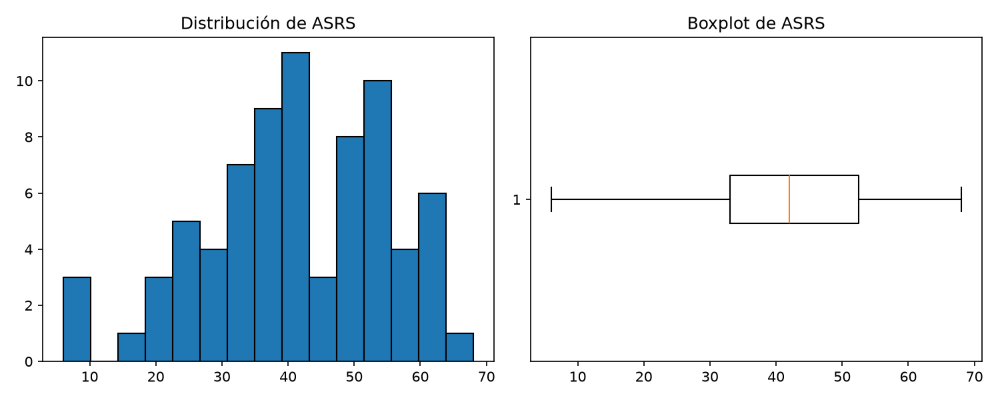
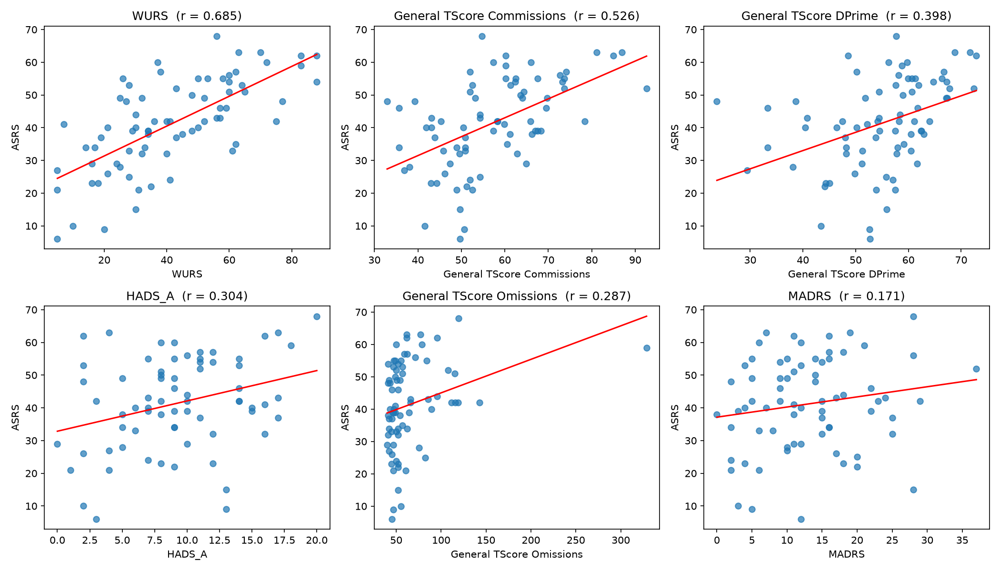
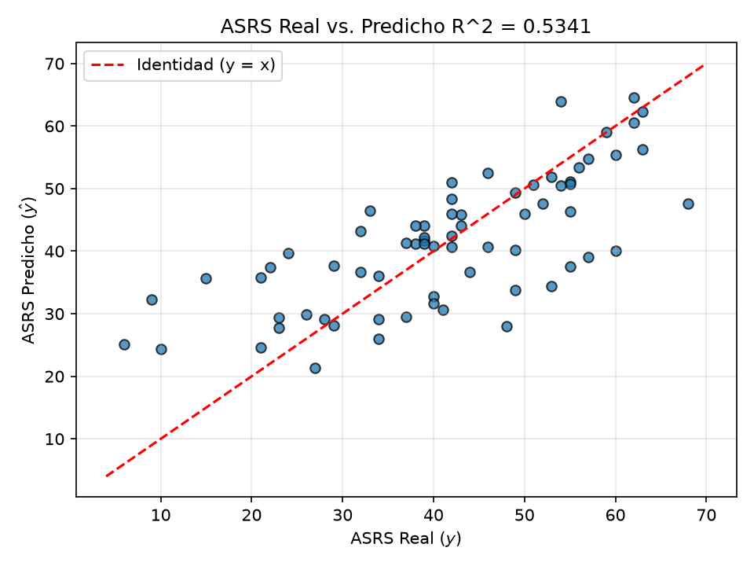
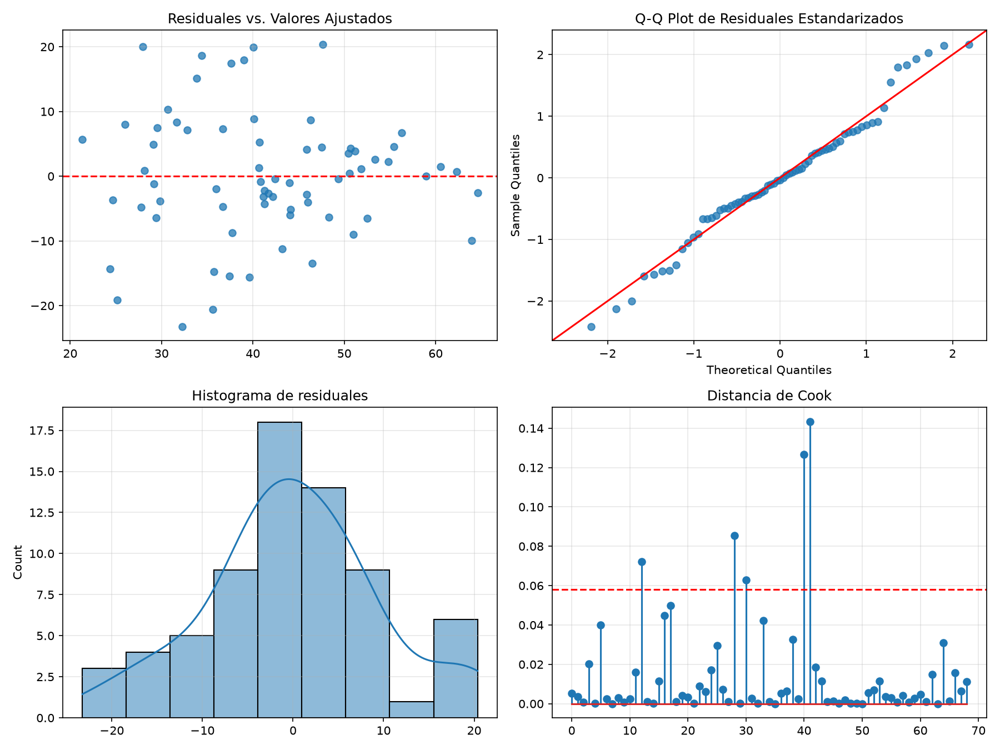
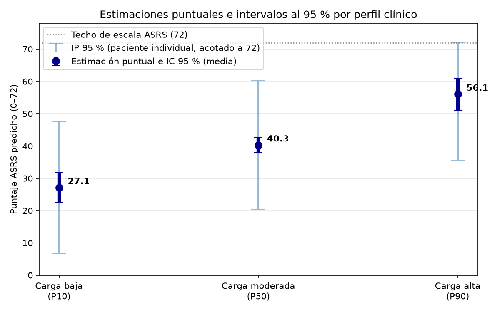

<!-- _class: lead -->
<!-- _paginate: false -->

UABC (Universidad Autónoma de Baja California) · Licenciatura en Ciencia de Datos

# Severidad de Síntomas de TDAH en Adultos (`ASRS`)

¿En qué medida la severidad actual del <strong>Trastorno por Déficit de Atención e Hiperactividad (TDAH)</strong> se explica por los <strong>síntomas en la infancia</strong>, la <strong>impulsividad objetiva</strong> y la <strong>ansiedad comórbida</strong> mediante Regresión Lineal Múltiple?

<strong>Autores:</strong> Mariana Salazar · Luis Alejandro Luna Martínez 
<strong>Materia:</strong> Análisis de Regresión y Correlación (ARC) · <strong>Profesora:</strong> Cynthia Calderón García 
Dataset clínico <em>HYPERAKTIV</em> (Hicks et al., 2021) · 26 de noviembre de 2026 
<em>Siglas:</em> <code>ASRS</code> (<em>Adult ADHD Self-Report Scale</em>).

<!--
MARIANA (~1 min):
- El TDAH inicia en la infancia y suele persistir en la adultez.
- Evaluarlo en adultos es complejo porque depende mucho del autorreporte.
- Dataset clínico HYPERAKTIV (Hicks et al., 2021).
- Pregunta: ¿Cuánto de la severidad actual (ASRS) se explica por síntomas infantiles (WURS), impulsividad objetiva (CPT-II) y ansiedad (HADS_A)?
-->

---

Parte 1 · Mariana

## 1. ¿Por qué Regresión Lineal Múltiple y CRISP-ML(Q)?

  

    <strong>Corte transversal (no series de tiempo)</strong>
    

      Cada fila representa un paciente único evaluado en una sola sesión clínica, sin orden cronológico ni mediciones repetidas.
    

  

  

    <strong>Validez estadística</strong>
    

      Múltiples predictores lineales, muestra efectiva <code>n = 69 ≥ 30</code> e independencia confirmada (<code>Durbin-Watson = 2.174</code>).
    

  

  
1. Comprensión

  
→

  
2. Preparación

  
→

  
3. Modelado

  
→

  
4. Evaluación

  
→

  
5. Inferencia

  
→

  
6. Comunicación

  <strong>Flujo reproducible:</strong> 4 cuadernos Jupyter secuenciales (<code>01</code> a <code>04</code>) en Python 3.13 + <code>uv</code> siguiendo el marco <strong>CRISP-ML(Q)</strong>.

  <strong>Siglas:</strong> <code>CRISP-ML(Q)</code>: <em>Cross-Industry Standard Process for Machine Learning with Quality Assurance</em>.

<!--
MARIANA (~1 min):
- Corte transversal (no series de tiempo): cada fila es un paciente único evaluado una sola vez, sin orden temporal.
- Requisitos cumplidos: más de 2 predictores, n = 69 >= 30 y Durbin-Watson = 2.174 (sin autocorrelación).
- Metodología CRISP-ML(Q): flujo reproducible en 4 notebooks (01 a 04).
-->

---

Parte 1 · Mariana

## 2. Variables Clínicas y Control de Fuga de Datos

| Rol | Variable | Instrumento | Qué mide y escala |
| :---: | :--- | :--- | :--- |
| **$Y$** | **`ASRS`** | *Adult ADHD Self-Report Scale* (OMS) | Severidad actual autorreportada (`0–72`, 18 ítems DSM) |
| **$X_1$** | **`WURS`** | *Wender Utah Rating Scale* | Síntomas retrospectivos en la infancia (`0–100`, corte `≥ 46`) |
| **$X_2$** | **`Commissions`** | *Conners' CPT-II* (`General TScore`) | Impulsividad objetiva en prueba computarizada (`T > 60` elevado) |
| **$X_3$** | **`HADS_A`** | *Hospital Anxiety & Depression Scale* | Ansiedad comórbida (`0–21`, `≥ 11` clínicamente significativa) |

  <strong>Prevención de fuga de información (<em>data leakage</em>):</strong> Se excluyeron explícitamente <code>ID</code> y los diagnósticos binarios directos <code>ADHD</code> y <code>ADD</code>, ya que equivalen al diagnóstico mismo.

  <strong>Siglas:</strong> <code>OMS</code>: Organización Mundial de la Salud · <code>DSM</code>: <em>Diagnostic and Statistical Manual of Mental Disorders</em> · <code>CPT-II</code>: <em>Conners' Continuous Performance Test II</em> · <code>HADS_A</code>: <em>Hospital Anxiety and Depression Scale – Anxiety</em> · <code>ADHD/ADD</code>: <em>Attention-Deficit/(Hyperactivity) Disorder</em>.

<!--
MARIANA (~1.5 min):
- Y (ASRS): escala OMS de severidad actual (0-72, 18 ítems DSM). Mayor puntaje = mayor severidad.
- 3 dimensiones complementarias:
  * X1 WURS (0-100): síntomas retrospectivos en infancia (corte orientativo >= 46).
  * X2 Commissions (puntaje T): impulsividad objetiva en prueba computarizada CPT-II (T > 60 elevado).
  * X3 HADS_A (0-21): ansiedad comórbida (>= 11 clínica).
- Control de fuga de datos: excluimos ID, ADHD y ADD porque equivalen al diagnóstico mismo.
-->

---

Parte 1 · Mariana

## 3. EDA: Distribución de `ASRS` y Correlaciones ($r$)

  

    
  

  

    <table>
      <thead><tr><th>Variable candidata</th><th><i>r</i></th><th><i>p</i>-valor</th></tr></thead>
      <tbody>
        <tr class="hl"><td><code>WURS</code></td><td>0.685</td><td>&lt; 0.001</td></tr>
        <tr class="hl"><td><code>Commissions</code></td><td>0.526</td><td>&lt; 0.001</td></tr>
        <tr><td><code>DPrime</code></td><td>0.398</td><td>&lt; 0.001</td></tr>
        <tr class="hl"><td><code>HADS_A</code></td><td>0.304</td><td>0.011</td></tr>
        <tr class="muted-row"><td><code>MADRS</code></td><td>0.171</td><td>0.154</td></tr>
        <tr class="muted-row"><td><code>HADS_D</code></td><td>0.112</td><td>0.361</td></tr>
        <tr class="muted-row"><td><code>AGE</code></td><td>−0.116</td><td>0.320</td></tr>
      </tbody>
    </table>
    

      <strong><i>n</i> = 75 integrados:</strong> Media <code>41.4</code>, Mediana <code>42.0</code>, sin valores atípicos (ligera cola izquierda de 3 pacientes).
    

    

      <strong>Siglas:</strong> <code>EDA</code>: Análisis Exploratorio de Datos · <code>MADRS</code>: <em>Montgomery–Åsberg Depression Rating Scale</em> · <code>HADS_D</code>: <em>HADS – Depression</em> · <code>AGE</code>: Edad.
    

  

<!--
MARIANA (~1.5 min):
- Señalar gráfica (izq.): n = 75, media 41.4, mediana 42.0, distribución simétrica y sin atípicos (ligera cola izquierda de 3 pacientes).
- Señalar tabla (der.):
  * WURS (r = 0.685, p < 0.001): correlación fuerte.
  * Commissions (r = 0.526, p < 0.001): prueba objetiva conectada con autorreporte.
  * HADS_A (r = 0.304, p = 0.011): significativa débil-moderada.
  * MADRS, HADS_D y AGE: no significativas (p > 0.15).
-->

---

Parte 1 · Mariana

## 4. Gráficas de Dispersión y Descarte de Candidatas

  

    
  

  

    

      <strong>Descarte de <code>Omissions</code> (<i>r</i> = 0.287)</strong>
      

        Un único punto influyente (<code>≈ 330</code>) jalaba artificialmente la recta de ajuste; sin él, la relación lineal desaparece.
      

    

    

      <strong>Descarte de <code>DPrime</code> (<i>r</i> = 0.398)</strong>
      

        Alta colinealidad con <code>Commissions</code> (<code>r = 0.88</code>); ambas miden discriminación/impulsividad en el mismo test <code>CPT-II</code> (<em>Conners' Continuous Performance Test II</em>).
      

    

  

<!--
MARIANA (~1 min):
- Regla clave: siempre graficar, no confiar solo en r.
- Omissions (r = 0.287) descartada: un solo paciente extremo (~330) jalaba la recta; sin él, la relación desaparece.
- DPrime (r = 0.398) descartada: alta colinealidad con Commissions (r = 0.88) dentro del mismo test CPT-II.
-->

---

Parte 1 · Mariana → Transición a Richie

## 5. Impacto Clínico: Peso por +1 Desviación Estándar

  Como cada escala tiene unidades distintas, comparamos el cambio esperado en <code>ASRS</code> al aumentar <strong>+1 DE muestral</strong> de cada predictor (<em>ceteris paribus</em>):

  

    
+7.7 pts

    
<code>WURS</code> (<i>X</i>1)

    
Pesa el doble que <code>Commissions</code>; principal impulsor de severidad.

  

  

    
+3.8 pts

    
<code>Commissions</code> (<i>X</i>2)

    
La prueba objetiva aporta señal clínica independiente.

  

  

    
+0.6 pts

    
<code>HADS_A</code> (<i>X</i>3)

    
Efecto marginal al controlar por historia infantil.

  

  <strong>Interpretación clínica:</strong> Quien reporta mayor carga sintomática desde la infancia y mayor desinhibición objetiva tiende a presentar puntuaciones más altas de <code>ASRS</code>.

  <strong>Siglas:</strong> <code>DE</code>: Desviación Estándar · <code>WURS</code>: <em>Wender Utah Rating Scale</em> · <code>HADS_A</code>: <em>Hospital Anxiety and Depression Scale – Anxiety</em>.

<!--
MARIANA (~1 min):
- Como las escalas son distintas, comparamos el efecto de +1 DE muestral (ceteris paribus):
  * WURS: +7.7 pts de ASRS (pesa el doble que Commissions).
  * Commissions: +3.8 pts (aporta señal objetiva independiente).
  * HADS_A: +0.6 pts (efecto marginal al controlar por las otras dos).
- Transición: ceder la palabra a Richie.
-->

---

Parte 2 · Richie

## 6. Ingeniería de Datos y Validación por `VIF`

  

    <strong>Protocolo de Calidad e Integración</strong>
    <ul style="font-size: 0.74em; margin: 10px 0 0 0; padding-left: 20px; color: #334155;">
      <li>Cruce (<em>inner join</em>) de 3 CSVs por <code>ID</code> (<code>sep=";"</code>, <code>utf-8-sig</code>).</li>
      <li>Filtro CPT-II: <code>Raw Score Omissions &lt; 300</code>.</li>
      <li>Depuración de 885 columnas → <strong><i>n</i> = 75</strong> integrados.</li>
      <li>Casos completos: 1 nulo en <code>WURS</code>, 6 en <code>HADS_A</code> → <strong><i>n</i> = 69</strong>.</li>
    </ul>
  

  

    <table>
      <thead><tr><th>Predictor</th><th><code>VIF</code></th><th>Diagnóstico</th></tr></thead>
      <tbody>
        <tr><td><code>WURS</code></td><td><strong>1.623</strong></td><td>Sin colinealidad</td></tr>
        <tr><td><code>Commissions</code></td><td><strong>1.390</strong></td><td>Sin colinealidad</td></tr>
        <tr><td><code>HADS_A</code></td><td><strong>1.205</strong></td><td>Sin colinealidad</td></tr>
      </tbody>
    </table>
    

$$\text{VIF}_j = \frac{1}{1 - R_j^2} < 2 \quad (\text{umbral clásico } < 5)$$

  

  <strong>Siglas:</strong> <code>VIF</code>: <em>Variance Inflation Factor</em> (Factor de Inflación de la Varianza) · <code>CSV</code>: <em>Comma-Separated Values</em> · <code>CPT-II</code>: <em>Conners' Continuous Performance Test II</em>.

<!--
RICHIE (~1.5 min):
- Integración: inner join de 3 CSVs por ID (sep=";", utf-8-sig).
- Filtro de calidad CPT-II: Raw Score Omissions < 300 para descartar sesiones inválidas.
- Depuración: 885 columnas -> n = 75 integrados -> n = 69 casos completos (1 nulo en WURS, 6 en HADS_A).
- Multicolinealidad (VIF): WURS = 1.623, Commissions = 1.390, HADS_A = 1.205 (todos < 2, umbral < 5).
-->

---

Parte 2 · Richie

## 7. Modelo MCO Estimado, Bondad de Ajuste y Pruebas $F$ / $t$

$$\widehat{\text{ASRS}}_i = 7.6350 + 0.3678\,\text{WURS}_i + 0.3079\,\text{Commissions}_i + 0.1273\,\text{HADS\_A}_i$$

  

    
53.41 %

    
<i>R</i>2 (<i>R</i>2adj = 0.5126)

    
<code>RMSE = 9.90</code> puntos de <code>ASRS</code>

  

  

    
24.84

    
Prueba <i>F</i>(3, 65)

    
<code>p = 8.00e-11</code> (globalmente significativo)

  

  

    
2 / 3 sig.

    
Pruebas <i>t</i> individuales

    
<code>WURS</code> (<code>p&lt;0.001</code>), <code>Commissions</code> (<code>p=0.010</code>) <code>HADS_A</code> (<code>p=0.655</code>), <code>const</code> (<code>p=0.216</code>)

  

  <strong>Siglas:</strong> <code>MCO</code>: Mínimos Cuadrados Ordinarios · <code>RMSE</code>: <em>Root Mean Squared Error</em> (Raíz del Error Cuadrático Medio) · <code>R2adj</code>: R² ajustado.

<!--
RICHIE (~1.5 min):
- Ecuación: ASRS = 7.6350 + 0.3678*WURS + 0.3079*Commissions + 0.1273*HADS_A.
- Ajuste global: R^2 = 53.41 % (R^2_adj = 0.5126), RMSE = 9.90.
- Prueba F(3, 65) = 24.84 (p = 8.00e-11, altamente significativo).
- Pruebas t: WURS (p < 0.001) y Commissions (p = 0.010) significativos; HADS_A (p = 0.655) y const (p = 0.216) no significativos.
-->

---

Parte 2 · Richie

## 8. Ajuste Real vs. Predicho y Diagnóstico de Residuales

  

    
  

  

    
  

  <strong>Supuestos cumplidos (<i>α</i> = 0.05):</strong>
  Normalidad Shapiro-Wilk <code>p = 0.2634</code> (✓) ·
  Homocedasticidad Breusch-Pagan <code>p = 0.0796</code> (✓) ·
  Independencia <code>DW = 2.174</code> (✓) ·
  Cook <code>0 casos &gt; 1</code> (✓)

  <strong>Siglas:</strong> <code>DW</code>: Estadístico de Durbin-Watson (prueba de autocorrelación).

<!--
RICHIE (~1.5 min):
- Real vs. predicho (izq.): puntos alineados a la diagonal identidad sin curvaturas.
- Supuestos cumplidos (alfa = 0.05):
  * Normalidad: Shapiro-Wilk p = 0.2634 (OK).
  * Homocedasticidad: Breusch-Pagan p = 0.0796 (OK, cerca del 5 %).
  * Independencia: DW = 2.174 (OK).
  * Influyentes: Cook 0 casos > 1 (OK).
- Ese p = 0.0796 y el p de HADS_A motivaron probar transformaciones.
-->

---

Parte 2 · Richie

## 9. Transformaciones y Reversión a Escala Original

| Modelo evaluado | `RMSE` (escala `ASRS`) | Shapiro-Wilk $p$ | Breusch-Pagan $p$ | Veredicto |
| :--- | :---: | :---: | :---: | :--- |
| **Base lineal** | **9.61** | **0.263** (✓) | **0.080** (✓) | **Elegido (cumple todo)** |
| $\ln(\text{ASRS})$ | 10.51 | `&lt; 0.001` (✗) | `0.027` (✗) | Estira cola izquierda |
| $\sqrt{\text{ASRS}}$ | 9.73 | `0.013` (✗) | `0.022` (✗) | Rompe normalidad |
| Parsimonioso (sin `HADS_A`) | 9.63 | `0.283` (✓) | `0.041` (✗) | Rompe homocedasticidad |

  

Reversión: $\widehat{\text{ASRS}} = e^{\hat z + \hat\sigma^2/2}$ &nbsp;y&nbsp; $\widehat{\text{ASRS}} = \hat z^2 + \hat\sigma^2$

  

  

    <strong>Conclusión metodológica:</strong> El modelo lineal base es el único que preserva todos los supuestos y minimiza el error.
  

  <strong>Siglas:</strong> <code>RMSE</code>: <em>Root Mean Squared Error</em> · <code>ASRS</code>: <em>Adult ADHD Self-Report Scale</em> · <code>HADS_A</code>: <em>Hospital Anxiety and Depression Scale – Anxiety</em>.

<!--
RICHIE (~1.5 min):
- Comparación justa: se revirtieron ln(ASRS) y sqrt(ASRS) a escala original (e^(z + sigma^2/2) y z^2 + sigma^2).
- ln(ASRS) y sqrt(ASRS): estiran la cola izquierda, rompen normalidad (p < 0.001 y 0.013), empeoran homocedasticidad y suben el RMSE.
- Sin HADS_A: sube ligeramente R^2_adj, pero rompe homocedasticidad (p = 0.041 < 0.05).
- Decisión: el modelo lineal base es el único que cumple todos los supuestos y minimiza el error (RMSE = 9.61).
-->

---

Parte 2 · Richie & Cierre Conjunto

<h2 style="margin-bottom: 12px;">10. Pronósticos en 3 Perfiles Clínicos y Conclusión</h2>

  

    
  

  

    <table style="font-size: 0.54em;">
      <thead><tr><th>Perfil</th><th>Pred.</th><th>IC 95 %</th><th>IP 95 %</th></tr></thead>
      <tbody>
        <tr><td><strong>Baja (P10)</strong></td><td><strong>27.14</strong></td><td>[22.48, 31.81]</td><td>[6.82, 47.46]</td></tr>
        <tr><td><strong>Mod. (P50)</strong></td><td><strong>40.31</strong></td><td>[37.90, 42.72]</td><td>[20.39, 60.23]</td></tr>
        <tr class="hl"><td><strong>Alta (P90)</strong></td><td><strong>56.06</strong></td><td>[51.11, 61.00]</td><td>[35.67, 72.00]*</td></tr>
      </tbody>
    </table>
    
*Límite estadístico superior 76.44 acotado al máximo clínico (72).

    

      <strong>Siglas:</strong> <code>P10/P50/P90</code>: Percentiles 10, 50 y 90 · <code>IC</code>: Intervalo de Confianza · <code>IP</code>: Intervalo de Predicción.
    

  

  

    <strong>Cierre clínico:</strong> Brecha clara de <strong>28.9 puntos</strong> útil para <strong>cribado y estratificación</strong>, pero el IP individual de <code>±20 pts</code> confirma que <strong>complementa y no sustituye</strong> la entrevista clínica.
  

<!--
RICHIE & MARIANA (~1.5 min):
- Sin extrapolación: perfiles basados en percentiles P10, P50 y P90 de la muestra (n = 69):
  * Carga baja (P10): 27.14 (IC [22.48, 31.81], IP [6.82, 47.46]).
  * Carga moderada (P50): 40.31 (IC [37.90, 42.72], IP [20.39, 60.23]).
  * Carga alta (P90): 56.06 (IC [51.11, 61.00], IP [35.67, 72.00] acotado al máximo clínico 72).
- Cierre conjunto:
  * Brecha de 28.9 puntos útil para cribado y estratificación.
  * IP individual de +-20 puntos (~47 % varianza no explicada) -> complementa, no sustituye la entrevista clínica.
-->

---

<!-- _class: lead -->
<!-- _paginate: false -->

Fin de la Presentación

# ¡Muchas Gracias por su Atención!

¿Preguntas o comentarios?

<strong>Mariana Salazar · Luis Alejandro Luna Martínez</strong> 
Análisis de Regresión y Correlación (ARC) · Universidad Autónoma de Baja California (UABC) 
<em>Código y reporte reproducible:</em> <code>github.com/a1252765/ARC_project</code>

<!--
Agradecer y abrir ronda de preguntas.

BANCO RÁPIDO DE Q&A:
- ¿Por qué dejaron HADS_A si p = 0.655? Al quitarla se rechaza homocedasticidad (Breusch-Pagan p = 0.041 < 0.05); mantenerla preserva supuestos, baja el RMSE (9.61 vs 9.63) y controla ansiedad.
- ¿Por qué empeoró ln(ASRS)? ASRS tenía ligera cola izquierda (3 pacientes 6-10); ln separó esos bajos y destruyó normalidad (p < 0.001).
- ¿Cómo evitaron extrapolación? Usando percentiles observados P10, P50 y P90 de n = 69.
- ¿Por qué IP llega a 76.44 en Carga Alta? MCO asume respuesta no acotada; reportamos el valor estadístico (76.44) y el acotado al dominio clínico (72.00).
-->
