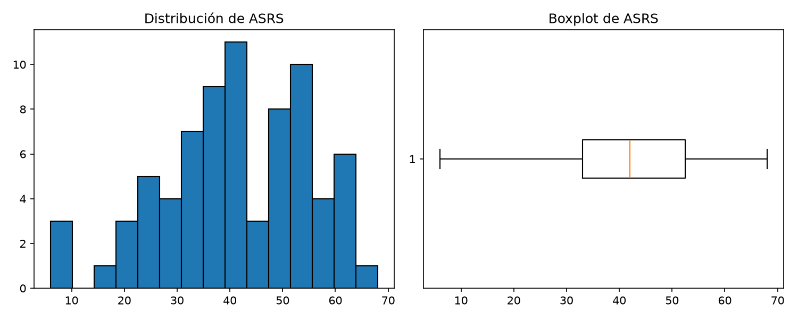
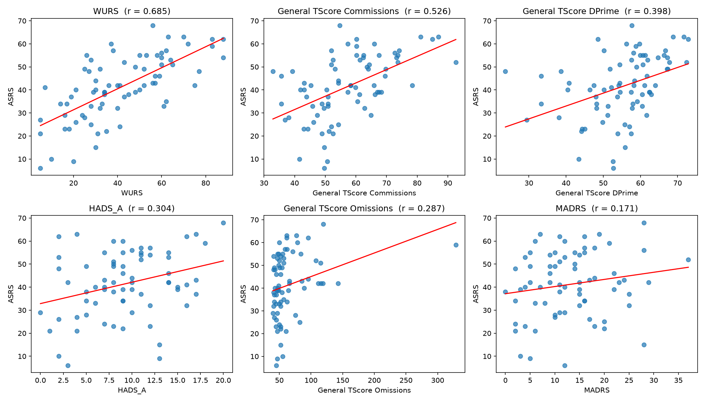
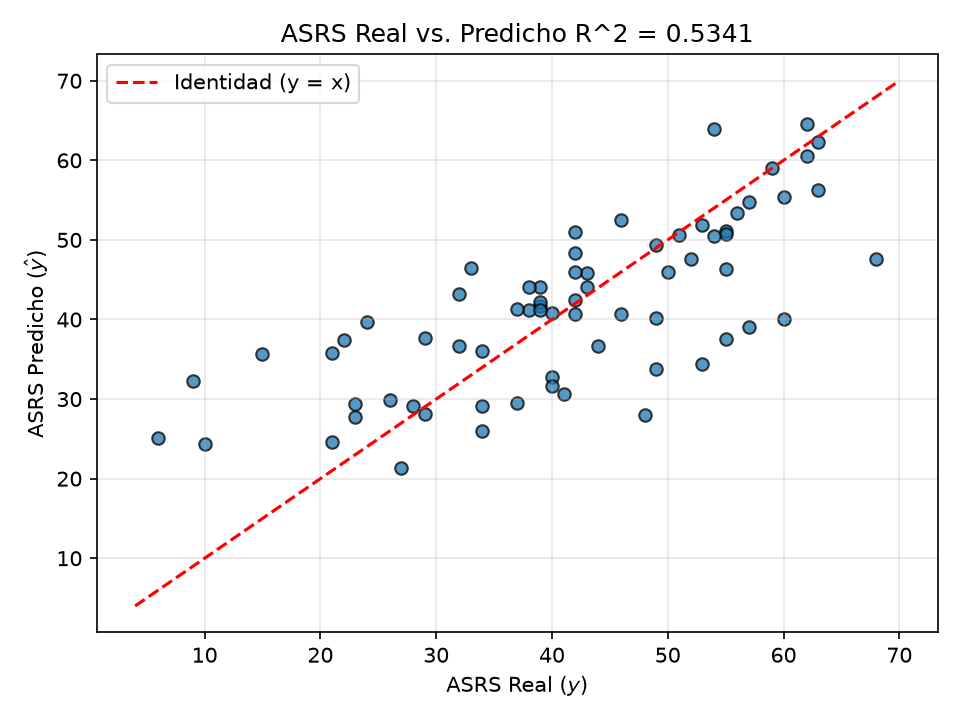
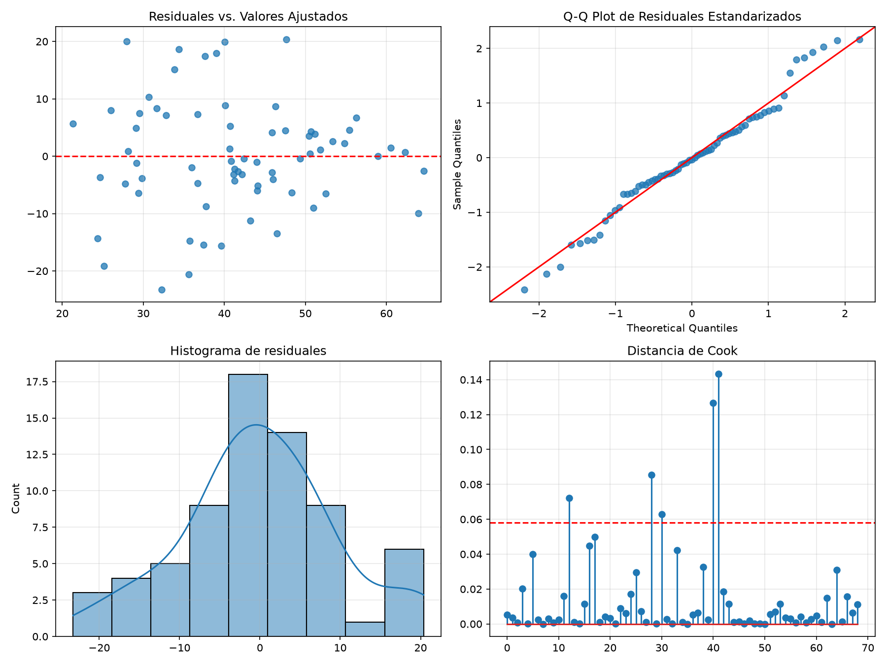
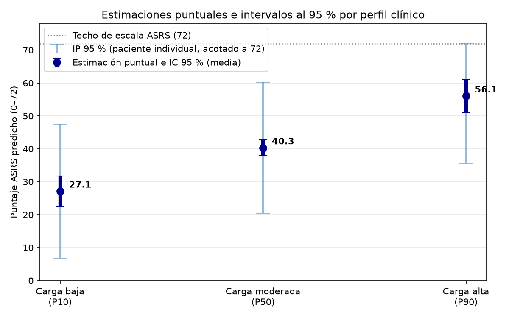

# 1. Introducción y planteamiento del problema

El Trastorno por Déficit de Atención e Hiperactividad (TDAH) es un trastorno del neurodesarrollo que comienza en la infancia y que, en una proporción importante de los casos, persiste en la vida adulta. En adultos suele manifestarse como dificultades sostenidas de atención, desorganización e impulsividad, y con frecuencia coexiste con síntomas de ansiedad o depresión. Evaluarlo en esta etapa resulta complejo porque depende en gran medida de escalas autorreportadas sobre los síntomas actuales y retrospectivos de la infancia.

En este proyecto analizamos el conjunto de datos clínico **HYPERAKTIV** (Hicks et al., 2021), que reúne información de pacientes adultos evaluados por sospecha de TDAH. La base integra cuestionarios clínicos autorreportados, variables demográficas, métricas de actigrafía y resultados de una prueba computarizada de atención sostenida e impulsividad conocida como **CPT-II** (*Conners' Continuous Performance Test II*).

**Pregunta de investigación:** ¿En qué medida la severidad actual de los síntomas de TDAH en adultos, medida mediante la escala `ASRS`, puede explicarse a partir de los síntomas retrospectivos de TDAH en la infancia (`WURS`), el desempeño objetivo en una prueba de impulsividad (`General TScore Commissions`) y el nivel de ansiedad comórbida (`HADS_A`)?

**Objetivo general:** Construir, diagnosticar y evaluar un modelo de **Regresión Lineal Múltiple** estimado por **Mínimos Cuadrados Ordinarios (MCO)** que explique la puntuación `ASRS`, interpretando sus parámetros en contexto clínico, evaluando transformaciones funcionales con reversión a la escala original y generando estimaciones puntuales con intervalos de confianza y predicción al 95 % para perfiles clínicos representativos.

---

# 2. Justificación del método y marco metodológico

## 2.1 Regresión lineal múltiple frente a series de tiempo

Se eligió un modelo de **Regresión Lineal Múltiple** —y no un modelo de series de tiempo— porque los datos de HYPERAKTIV son de **corte transversal**: cada fila representa a un paciente distinto evaluado en una única ocasión, sin orden cronológico ni mediciones repetidas de un mismo individuo. Asimismo, el objetivo no es proyectar la evolución temporal de una serie, sino cuantificar cómo varía `ASRS` en función de múltiples características clínicas y conductuales del paciente.

El enfoque cumple holgadamente los requisitos de validez estadística del curso: se cuenta con más de una variable independiente con relación lineal clara respecto a `ASRS` y un tamaño de muestra efectivo de **$n = 69 \ge 30$** pacientes. Como verificación posterior, el estadístico de Durbin-Watson de los residuales ($\text{DW} = 2.174$) confirma la ausencia de autocorrelación, coherente con observaciones independientes.

## 2.2 Metodología CRISP-ML(Q)

El flujo de trabajo se organizó bajo el estándar **CRISP-DM / CRISP-ML(Q)** (*Cross-Industry Standard Process for Machine Learning with Quality Assurance*), asegurando reproducibilidad en Python (`uv`), trazabilidad en Git, prevención de fuga de información y validación formal de supuestos en cuatro cuadernos independientes:

| Fase CRISP-ML(Q) | Implementación en el proyecto | Entregable / Rúbrica |
|---|---|---|
| 1. Comprensión del problema y los datos | Definición de `ASRS` como $Y$, auditoría de fuentes HYPERAKTIV y EDA | Notebooks 01 y 02 (1a, 1b) |
| 2. Preparación de los datos | Limpieza, integración por `ID`, exclusión de fuga de datos y control por VIF | Notebooks 01 y 02 (1a, 1b) |
| 3. Modelado | Formulación escalar/matricial y estimación MCO en `statsmodels` | Notebook 03 (2a, 2b) |
| 4. Evaluación y aseguramiento de calidad | $R^2$, $R^2_{\text{adj}}$, pruebas $F$ y $t$, real vs. predicho, residuales y transformaciones | Notebooks 03 y 04 (3a, 4a–4c) |
| 5. Inferencia aplicada | Estimaciones puntuales, IC 95 % e IP 95 % para perfiles clínicos (P10, P50, P90) | Notebook 04 (5a) |
| 6. Comunicación | Reporte técnico final en PDF y exposición oral | Reporte y defensa |

---

# 3. Descripción clínica e ingeniería de los datos

## 3.1 Ingeniería de datos: limpieza e integración ($n = 75 \rightarrow n = 69$)

El dataset HYPERAKTIV se compone originalmente de tres archivos delimitados por punto y coma (`sep=";"`): `patient_info.csv` (demografía, diagnósticos y escalas clínicas), `features.csv` (actigrafía y variabilidad cardiaca) y `CPT_II_ConnersContinuousPerformanceTest.csv` (métricas neuropsicológicas con codificación `utf-8-sig`). En `notebooks/01_data_ingestion_and_cleaning.ipynb` se ejecutó el siguiente protocolo de calidad:

- **Integración por `ID`:** verificación de unicidad de pacientes y cruce (*inner join*) entre las tres tablas.
- **Filtro de validez clínica en CPT-II:** se aplicó la regla `Raw Score Omissions < 300` para descartar sesiones inválidas en las que el paciente no respondió o falló el registro de teclado.
- **Depuración estructural y de variable objetivo:** se descartaron filas sin registro en `ASRS` y columnas de detalle ensayo por ensayo, generando `data/processed/hyperaktiv_arc_clean.csv` con **$n = 75$ pacientes y 885 columnas**.
- **Prevención de fuga de información (*data leakage*):** se excluyeron explícitamente el identificador `ID` y las etiquetas diagnósticas directas (`ADHD`, `ADD`), ya que equivalen al diagnóstico mismo.

Al restringir el modelado a casos completos sobre `ASRS` y los tres predictores confirmados, se registraron únicamente 1 dato faltante en `WURS` y 6 en `HADS_A` (0 en `ASRS` y `Commissions`), dejando una **muestra efectiva de $n = 69$ pacientes**.

## 3.2 Descripción clínica de las variables

- **Variable respuesta ($Y$ — `ASRS`):** *Adult ADHD Self-Report Scale* v1.1 (Kessler et al., 2005), desarrollada junto con la OMS. Consta de 18 ítems basados en criterios DSM (inatención e hiperactividad/impulsividad) calificados de 0 (*nunca*) a 4 (*muy frecuentemente*), con rango total de **0 a 72 puntos**. A mayor puntaje, mayor severidad percibida. Es una herramienta de cribado y cuantificación de síntomas, no un diagnóstico definitivo por sí sola.

| Símbolo y Variable | Instrumento | Qué mide | Escala / Unidades | Interpretación clínica |
|---|---|---|---|---|
| $X_1$: `WURS` | Wender Utah Rating Scale (Ward et al., 1993) | Síntomas retrospectivos de TDAH en la infancia | Continua (0–100) | Valores $\ge 46$ se usan como punto de corte orientativo de TDAH infantil |
| $X_2$: `General TScore Commissions` | Conners' CPT-II (Conners, 2000) | Errores de comisión: responder cuando se debía inhibir la respuesta (impulsividad) | Puntaje $T$ (media 50, DE 10) | $T > 60$ indica impulsividad o desinhibición elevada |
| $X_3$: `HADS_A` | Hospital Anxiety and Depression Scale (Zigmond & Snaith, 1983) | Sintomatología de ansiedad comórbida | Continua (0–21) | 0–7 normal, 8–10 limítrofe, $\ge 11$ clínicamente significativa |

Esta combinación evalúa al paciente desde tres dimensiones complementarias: historia del neurodesarrollo (`WURS`), desempeño neuropsicológico objetivo (`Commissions`) y estado emocional comórbido (`HADS_A`).

---

# 4. Análisis exploratorio de datos (EDA), correlación y selección de predictores

## 4.1 Distribución de la variable respuesta (`ASRS`)

En la base integrada ($n = 75$), los puntajes de `ASRS` oscilan entre **6 y 68 puntos**, con media $= 41.39$, mediana $= 42.0$ y desviación estándar $= 13.90$. La distribución es aproximadamente simétrica, con una ligera cola izquierda formada por tres pacientes con puntajes bajos (entre 6 y 10). El diagrama de caja no muestra valores atípicos y la cercanía entre media y mediana indica ausencia de sesgo fuerte que obligue a transformar $Y$ de entrada.

## 4.2 Coeficientes de correlación de Pearson ($r$) (Rúbrica 1b)

Se calculó la correlación de Pearson ($r$) y su $p$-valor frente a `ASRS` para todas las variables numéricas candidatas (`reports/tables/correlaciones_asrs.csv`). Dado que las variantes *Adhd*, *General* y *Neuro* del CPT-II representan la misma métrica contrastada contra distintos baremos de referencia, se adoptó consistentemente la versión *General*:

| Variable candidata | $r$ con `ASRS` | $p$-valor | $n$ | Interpretación |
|---|---:|---:|---:|---|
| `WURS` | `0.685` | `< 0.001` | 74 | Positiva fuerte, altamente significativa |
| `General TScore Commissions` | `0.526` | `< 0.001` | 75 | Positiva moderada, altamente significativa |
| `General TScore DPrime` | `0.398` | `< 0.001` | 75 | Positiva moderada, significativa |
| `HADS_A` | `0.304` | `0.011` | 69 | Positiva débil a moderada, significativa |
| `General TScore Omissions` | `0.287` | `0.013` | 75 | Positiva débil (inflada por un punto influyente) |
| `MADRS` | `0.171` | `0.154` | 71 | No significativa |
| `HADS_D` | `0.112` | `0.361` | 69 | No significativa |
| `AGE` | `-0.116` | `0.320` | 75 | No significativa |

`WURS` presenta la asociación lineal más fuerte ($r = 0.685$), respaldando la continuidad evolutiva del TDAH desde la infancia hasta la adultez. `Commissions` ($r = 0.526$) conecta una prueba conductual objetiva con la severidad autorreportada, mientras que `HADS_A` ($r = 0.304$) refleja la frecuente comorbilidad ansiosa. En contraste, los síntomas depresivos (`MADRS`, `HADS_D`) y la edad (`AGE`) no muestran relación lineal significativa con `ASRS`.

## 4.3 Gráficas de dispersión (Rúbrica 1a)

El análisis gráfico complementa al coeficiente $r$:
- **`WURS`:** tendencia lineal positiva clara y dispersión homogénea sin patrón de embudo.
- **`Commissions` y `DPrime`:** tendencia lineal positiva con mayor dispersión que `WURS`.
- **`HADS_A`:** pendiente positiva leve con nube amplia.
- **`Omissions` (caso ilustrativo de descarte):** la mayoría de las observaciones se concentra entre 40 y 100, pero un único paciente cercano a 330 inclina artificialmente la recta de tendencia e infla su $r = 0.287$. Esto demuestra por qué el coeficiente de correlación siempre debe auditarse visualmente.
- **`MADRS`:** nube sin tendencia lineal, incluida como contraste.

## 4.4 Selección final de predictores y validación de multicolinealidad (VIF)

Al revisar la matriz de correlación entre candidatas se detectó colinealidad severa entre `General TScore Commissions` y `General TScore DPrime` ($r = 0.88$), por lo que se descartó `DPrime` y se conservó `Commissions` por su mayor correlación con `ASRS` y su interpretación directa como impulsividad. El resto de pares presentó $|r| \le 0.47$.

Para confirmar formalmente la ausencia de multicolinealidad entre los tres predictores elegidos se calculó el **Factor de Inflación de Varianza**:

$$\text{VIF}_j = \frac{1}{1 - R_j^2}$$

donde $R_j^2$ es el coeficiente de determinación al regresar $X_j$ contra los demás predictores (con constante). Todos los valores quedaron muy por debajo del umbral $\text{VIF} < 5$ (`reports/tables/ols_vif.csv`):

| Predictor ($X_j$) | VIF | Evaluación ($\text{VIF} < 5$) |
|---|---:|---|
| `WURS` | `1.623` | Cumple (sin multicolinealidad) |
| `General TScore Commissions` | `1.390` | Cumple (sin multicolinealidad) |
| `HADS_A` | `1.205` | Cumple (sin multicolinealidad) |

---

# 5. Modelado por Mínimos Cuadrados Ordinarios (MCO) e interpretación

## 5.1 Planteamiento formal del modelo (Rúbrica 2a)

El modelo poblacional en forma escalar es:

$$\text{ASRS}_i = \beta_0 + \beta_1\,\text{WURS}_i + \beta_2\,\text{Commissions}_i + \beta_3\,\text{HADS\_A}_i + \varepsilon_i, \quad i = 1, \dots, 69$$

bajo los supuestos clásicos de Gauss-Markov y normalidad: $\mathbb{E}[\varepsilon_i \mid \mathbf{X}] = 0$, $\text{Var}(\varepsilon_i \mid \mathbf{X}) = \sigma^2$, $\text{Cov}(\varepsilon_i, \varepsilon_j \mid \mathbf{X}) = 0$ ($i \neq j$) y $\varepsilon_i \sim \mathcal{N}(0, \sigma^2)$.

En forma matricial, $\mathbf{y} = \mathbf{X}\boldsymbol{\beta} + \boldsymbol{\varepsilon}$ con $\mathbf{y} \in \mathbb{R}^{69 \times 1}$ y $\mathbf{X} \in \mathbb{R}^{69 \times 4}$ (incluyendo la columna unitaria del intercepto). El estimador MCO que minimiza la suma de cuadrados residual $S(\boldsymbol{\beta}) = (\mathbf{y} - \mathbf{X}\boldsymbol{\beta})^\top(\mathbf{y} - \mathbf{X}\boldsymbol{\beta})$ es:

$$\hat{\boldsymbol{\beta}} = (\mathbf{X}^\top \mathbf{X})^{-1}\mathbf{X}^\top \mathbf{y}$$

La ecuación de regresión estimada resultante en `notebooks/03_ols_modeling_and_diagnostics.ipynb` es:

$$\widehat{\text{ASRS}}_i = 7.6350 + 0.3678\,\text{WURS}_i + 0.3079\,\text{Commissions}_i + 0.1273\,\text{HADS\_A}_i$$

## 5.2 Coeficientes, pruebas $t$, bondad de ajuste y prueba $F$ (Rúbrica 4a y 4b)

Los estimadores MCO, errores estándar, pruebas $t$ ($gl = 65$), $p$-valores e intervalos de confianza al 95 % (`reports/tables/ols_coefficients.csv`) se muestran a continuación:

| Término | $\hat{\beta}_j$ | Error Estándar | Estadístico $t$ | $p$-valor | IC 95 % | Significancia ($\alpha = 0.05$) |
|---|---:|---:|---:|---:|---|---|
| `const` ($\hat{\beta}_0$) | `7.6350` | `6.1095` | `1.2497` | `0.2159` | `[-4.5666, 19.8365]` | No significativo |
| `WURS` ($\hat{\beta}_1$) | `0.3678` | `0.0736` | `4.9957` | `< 0.0001` | `[0.2208, 0.5149]` | Significativo ($p < 0.001$) |
| `General TScore Commissions` ($\hat{\beta}_2$) | `0.3079` | `0.1162` | `2.6507` | `0.0101` | `[0.0759, 0.5399]` | Significativo ($p < 0.05$) |
| `HADS_A` ($\hat{\beta}_3$) | `0.1273` | `0.2833` | `0.4492` | `0.6547` | `[-0.4385, 0.6931]` | No significativo |

Las métricas globales del ajuste (`reports/tables/ols_summary_metrics.csv`) confirman:
- **Bondad de ajuste (Rúbrica 4a):** **$R^2 = 0.5341$** y **$R^2_{\text{ajustado}} = 0.5126$**, con error estándar residual **$\text{RMSE} = 9.9015$** puntos `ASRS` ($\text{AIC} = 516.08$, $\text{BIC} = 525.02$). El modelo explica el **53.41 %** de la variabilidad total de `ASRS` (51.26 % ajustado por $k = 3$ predictores), un nivel sólido en psicología clínica.
- **Significancia global — Prueba $F$ (Rúbrica 4b):** para $H_0: \beta_1 = \beta_2 = \beta_3 = 0$, se obtiene **$F(3, 65) = 24.8355$** con **$p = 8.00 \times 10^{-11} < 0.001$**. Se rechaza contundentemente $H_0$: el modelo en su conjunto es altamente significativo.
- **Significancia individual — Pruebas $t$ (Rúbrica 4b):** `WURS` ($t = 4.9957, p < 0.0001$) y `General TScore Commissions` ($t = 2.6507, p = 0.0101$) resultan significativos al 5 %, mientras que `HADS_A` ($t = 0.4492, p = 0.6547$) no aporta significancia marginal al controlar por los dos primeros.

## 5.3 Interpretación teórica y práctica de los parámetros (Rúbrica 2b)

- **Intercepto ($\hat{\beta}_0 = 7.6350$, $p = 0.2159$):** representa el puntaje esperado de `ASRS` cuando los tres predictores valen cero. Carece de interpretación clínica porque un puntaje $T$ de comisiones igual a 0 se ubica a 5 desviaciones estándar por debajo de la media poblacional ($T = 50$, mínimo observado $\approx 32.9$); su función es estrictamente matemática para posicionar el hiperplano de regresión.
- **`WURS` ($\hat{\beta}_1 = 0.3678$, $p < 0.0001$):** manteniendo constantes `Commissions` y `HADS_A` (*ceteris paribus*), cada punto adicional en síntomas infantiles se asocia con un aumento promedio de **0.3678 puntos** en `ASRS` ($\approx 3.68$ puntos por cada 10 puntos de `WURS`). Es el predictor dominante y refleja la continuidad neuroevolutiva del TDAH.
- **`General TScore Commissions` ($\hat{\beta}_2 = 0.3079$, $p = 0.0101$):** *ceteris paribus*, cada punto $T$ adicional en errores de comisión incrementa la `ASRS` esperada en **0.3079 puntos** ($\approx 3.08$ puntos por cada desviación estándar normativa de 10 puntos $T$). Demuestra que una medida objetiva de inhibición motora aporta información independiente al autorreporte retrospectivo.
- **`HADS_A` ($\hat{\beta}_3 = 0.1273$, $p = 0.6547$):** su efecto es positivo pero estadísticamente indistinguible de cero (el IC 95 % cruza el cero). Aunque la ansiedad correlacionaba bivariadamente con `ASRS` ($r = 0.304$), su efecto directo se diluye al controlar por `WURS` (con la cual comparte $r = 0.41$), sugiriendo que la ansiedad acompaña a la carga histórica del trastorno más que explicar de forma independiente la severidad actual.

**Comparación del peso práctico por escala (+1 desviación estándar muestral):** dado que las tres variables tienen escalas distintas, multiplicar cada coeficiente por la desviación estándar muestral ($n = 69$) permite comparar su impacto real:
- `WURS` (DE $\approx 20.8$): $0.3678 \times 20.8 \approx$ **+7.7 puntos** en `ASRS`.
- `General TScore Commissions` (DE $\approx 12.2$): $0.3079 \times 12.2 \approx$ **+3.8 puntos** en `ASRS`.
- `HADS_A` (DE $\approx 4.7$): $0.1273 \times 4.7 \approx$ **+0.6 puntos** en `ASRS`.

En términos prácticos, la historia de síntomas infantiles pesa aproximadamente el doble que la impulsividad en el CPT-II, y la ansiedad tiene un aporte marginal casi nulo al controlar por las otras dos variables.

---

# 6. Evaluación visual y diagnóstico de supuestos

## 6.1 Valores reales vs. valores predichos (Rúbrica 4c)

Los puntos se agrupan de manera consistente a lo largo de la recta identidad ($y = x$) sin patrones curvos sistemáticos. Acorde con un $R^2 = 0.5341$ y $\text{RMSE} = 9.9015$, se observa la contracción moderada hacia la media propia de MCO: ligera sobreestimación en puntajes muy bajos ($y < 15$) y ligera subestimación cerca del techo clínico ($y > 60$).

## 6.2 Diagnóstico gráfico y formal de residuales

Los contrastes estadísticos sobre los residuales (`reports/tables/ols_diagnostics.csv`) validan los supuestos del modelo lineal clásico al nivel $\alpha = 0.05$:

| Supuesto | Prueba / Métrica | Estadístico | $p$-valor / Criterio | Resultado ($\alpha = 0.05$) |
|---|---|---:|---:|---|
| Normalidad | Shapiro-Wilk ($W$) | `0.9780` | `p = 0.2634` | **Cumple** (Omnibus $p = 0.885$, JB $p = 0.991$) |
| Homocedasticidad | Breusch-Pagan ($\text{LM}$ / $F$) | `6.7705` / `2.3573` | `p = 0.0796` / `0.0798` | **Cumple al 5 %** (próximo al umbral) |
| Independencia | Durbin-Watson ($\text{DW}$) | `2.174` | Cercano a `2.0` | **Cumple** (sin autocorrelación) |
| Puntos influyentes | Distancia de Cook ($D_i$) | 5 casos $> 4/n$ (`0.058`) | **0 casos $> 1.0$** | **Estable** (sin observaciones distorsionantes) |

---

# 7. Evaluación de transformaciones y reversión a la escala original (Rúbrica 3a)

A pesar de que el modelo base cumple los supuestos al 5 %, el $p$-valor marginal de Breusch-Pagan ($p = 0.0796$) y la no significancia individual de `HADS_A` ($p = 0.6547$) motivaron contrastar en `notebooks/04_transformations_and_forecasting.ipynb` tres especificaciones alternativas sobre los mismos $n = 69$ pacientes:

1. **Modelo Log-Lineal ($\ln(\text{ASRS})$):** ajusta $\ln(Y_i) = \mathbf{x}_i^\top \boldsymbol{\gamma} + u_i$. Para revertir las predicciones a la escala original de `ASRS` corrigiendo el sesgo de retransformación log-normal se emplea:
   $$\widehat{\text{ASRS}}_i = \exp\!\left(\widehat{\ln Y}_i + \frac{\hat{\sigma}_u^2}{2}\right)$$
2. **Modelo Raíz Cuadrada ($\sqrt{\text{ASRS}}$):** ajusta $\sqrt{Y_i} = \mathbf{x}_i^\top \boldsymbol{\delta} + v_i$, con reversión a la escala original dada por:
   $$\widehat{\text{ASRS}}_i = \left(\widehat{\sqrt{Y}}_i\right)^2 + \hat{\sigma}_v^2$$
3. **Modelo Parsimonioso (lineal sin `HADS_A`):** conserva únicamente `WURS` y `General TScore Commissions` ($k = 2$).

Todos los modelos se compararon con **RMSE y $R^2$ evaluados en la misma escala original de `ASRS`** (`reports/tables/ols_transformations_comparison.csv`):

| Modelo | $k$ | $R^2_{\text{adj}}$ (escala modelo) | $R^2$ (escala `ASRS`) | RMSE (escala `ASRS`) | Shapiro-Wilk ($p$) | Breusch-Pagan ($p$) |
|---|---:|---:|---:|---:|---:|---:|
| **Base lineal (3 pred.)** | 3 | `0.5126` | **`0.5341`** | **`9.6102`** | **`0.2634`** | **`0.0796`** |
| Log-Lineal $\ln(\text{ASRS})$ | 3 | `0.4030` | `0.4427` | `10.5101` | `0.0000` | `0.0268` |
| Raíz cuadrada $\sqrt{\text{ASRS}}$ | 3 | `0.4726` | `0.5228` | `9.7259` | `0.0127` | `0.0215` |
| Parsimonioso (sin `HADS_A`) | 2 | `0.5185` | `0.5326` | `9.6251` | `0.2829` | `0.0411` |

**Justificación de conservar el modelo lineal base:**
- Las transformaciones cóncavas ($\ln$ y $\sqrt{\cdot}$) corrigen sesgos positivos (cola derecha), pero `ASRS` presenta una ligera **cola izquierda** (tres puntajes entre 6 y 10). Al aplicar $\ln$ o $\sqrt{\cdot}$, la cola inferior se estira, **se viola la normalidad** ($p < 0.0001$ y $p = 0.0127$), **empeora la heterocedasticidad** ($p = 0.0268$ y $p = 0.0215$) y **aumenta el error en escala original** ($\text{RMSE} = 10.5101$ y $9.7259$ vs. `9.6102`).
- Eliminar `HADS_A` (modelo parsimonioso) sube ligeramente $R^2_{\text{adj}}$ (`0.5185`), pero **incumple homocedasticidad** al 5 % (Breusch-Pagan $p = 0.0411 < 0.05$).
- En consecuencia, se **selecciona el modelo lineal base en escala original** como modelo final: es la única especificación que cumple simultáneamente todos los supuestos clásicos, minimiza el RMSE en puntos `ASRS` y mantiene la interpretabilidad directa de los coeficientes sin requerir transformación en los pronósticos finales.

---

# 8. Estimaciones puntuales para perfiles clínicos y utilidad práctica (Rúbrica 5a)

## 8.1 Definición de perfiles clínicos y pronósticos al 95 %

Para evaluar el desempeño práctico del modelo sin incurrir en extrapolación, se definieron **tres perfiles hipotéticos** con los percentiles **P10, P50 y P90** de cada predictor en la muestra efectiva ($n = 69$). Mediante `.get_prediction().summary_frame(alpha=0.05)` se calcularon la estimación puntual $\widehat{\text{ASRS}}$, el intervalo de confianza al 95 % para la media (IC 95 %) y el intervalo de predicción al 95 % para un paciente individual (IP 95 %), incluyendo además el pronóstico revertido de $\sqrt{\text{ASRS}}$ como referencia comparativa (`reports/tables/ols_forecasts.csv`):

| Perfil clínico | `WURS` | `Commissions` ($T$) | `HADS_A` | $\widehat{\text{ASRS}}$ (Base) | IC 95 % (media) | IP 95 % (individual) | IP 95 % acotado (0–72) | $\widehat{\text{ASRS}}$ ($\sqrt{Y}$ revert.) |
|---|---:|---:|---:|---:|---|---|---|---:|
| **Carga baja (P10)** | 16 | 43 | 3 | **`27.14`** | `[22.48, 31.81]` | `[6.82, 47.46]` | `[6.82, 47.46]` | `27.09` |
| **Carga moderada (P50)** | 38 | 57 | 9 | **`40.31`** | `[37.90, 42.72]` | `[20.39, 60.23]` | `[20.39, 60.23]` | `39.54` |
| **Carga alta (P90)** | 65 | 73 | 16 | **`56.06`** | `[51.11, 61.00]` | `[35.67, 76.44]` | `[35.67, 72.00]` | `57.62` |

- **Carga baja (P10):** pocos síntomas infantiles, impulsividad dentro del promedio y ansiedad normal (`HADS_A` 0–7) $\rightarrow$ severidad esperada baja-moderada ($\widehat{\text{ASRS}} = 27.14$).
- **Carga moderada (P50):** síntomas infantiles intermedios, impulsividad en el límite alto del promedio y ansiedad limítrofe (8–10) $\rightarrow$ severidad esperada intermedia ($\widehat{\text{ASRS}} = 40.31$), muy próxima a la media muestral ($41.4$).
- **Carga alta (P90):** síntomas infantiles sobre el punto de corte (`WURS` $\ge 46$), impulsividad elevada ($T > 60$) y ansiedad clínicamente significativa ($\ge 11$) $\rightarrow$ severidad esperada alta ($\widehat{\text{ASRS}} = 56.06$; el extremo superior del IP 95 % excede el máximo teórico de la escala y se acota clínicamente a 72).

## 8.2 Conclusión sobre utilidad clínica y limitaciones

- **Utilidad práctica:** El modelo distingue con claridad niveles crecientes de severidad clínica —una brecha de **28.92 puntos** entre los perfiles P10 y P90, con intervalos de confianza para la media completamente disjuntos— y demuestra que combinar historia retrospectiva (`WURS`) con una prueba conductual objetiva (`CPT-II Commissions`) resulta valioso como **apoyo cuantitativo al cribado y estratificación de riesgo**.
- **Limitaciones:** A nivel de un paciente individual, los intervalos de predicción al 95 % abarcan aproximadamente **$\pm 20$ puntos** (consecuencia de $\text{RMSE} = 9.90$ y de que $\approx 46.6\,\%$ de la variabilidad de `ASRS` responde a otros factores no medidos). Sumado al tamaño muestral moderado ($n = 69$) y al carácter autorreportado de `ASRS` y `WURS`, el modelo **no sustituye una evaluación clínica diagnóstica integral**.

---

# 9. Conclusiones generales

1. Se construyó y validó un modelo de Regresión Lineal Múltiple por MCO ($n = 69$) libre de multicolinealidad ($\text{VIF} \le 1.623$) y de fuga de información que explica el **53.41 %** de la varianza de la severidad de síntomas de TDAH en adultos ($R^2_{\text{adj}} = 0.5126$, $F(3,65) = 24.84$, $p < 0.001$).
2. Los síntomas retrospectivos de la infancia (`WURS`, $\hat{\beta}_1 = 0.3678, p < 0.0001$) y la impulsividad objetiva medida en el CPT-II (`General TScore Commissions`, $\hat{\beta}_2 = 0.3079, p = 0.0101$) son predictores positivos y estadísticamente significativos de `ASRS`, con `WURS` ejerciendo cerca del doble de peso práctico por desviación estándar (+7.7 vs. +3.8 puntos). La ansiedad (`HADS_A`, $p = 0.6547$) pierde significancia directa al controlar por la historia infantil.
3. El modelo lineal base en escala original satisface todos los supuestos clásicos (Shapiro-Wilk $p = 0.2634$, Breusch-Pagan $p = 0.0796$, Durbin-Watson $= 2.174$, 0 puntos con Cook $> 1.0$) y supera en precisión y cumplimiento de supuestos tanto a las transformaciones $\ln(\text{ASRS})$ y $\sqrt{\text{ASRS}}$ (evaluadas tras su reversión analítica a la escala original) como al modelo parsimonioso sin `HADS_A`.
4. Las estimaciones puntuales sobre perfiles clínicos representativos (P10, P50 y P90) confirman la coherencia clínica del modelo como instrumento de apoyo al cribado poblacional, manteniendo claridad transparente sobre la amplitud de la incertidumbre individual.

---

# Referencias

- Conners, C. K. (2000). *Conners' Continuous Performance Test II (CPT II)*. Multi-Health Systems.
- Hicks, S. A., Stautland, A., Fasmer, O. B., Førland, W., Hammer, H. L., Halvorsen, P., … Riegler, M. A. (2021). HYPERAKTIV: An activity dataset from patients with attention-deficit/hyperactivity disorder (ADHD). *Proceedings of the 12th ACM Multimedia Systems Conference*.
- Kessler, R. C., Adler, L., Ames, M., et al. (2005). The World Health Organization Adult ADHD Self-Report Scale (ASRS). *Psychological Medicine, 35*(2), 245–256.
- Ward, M. F., Wender, P. H., & Reimherr, F. W. (1993). The Wender Utah Rating Scale: An aid in the retrospective diagnosis of childhood attention deficit hyperactivity disorder. *American Journal of Psychiatry, 150*(6), 885–890.
- Zigmond, A. S., & Snaith, R. P. (1983). The Hospital Anxiety and Depression Scale. *Acta Psychiatrica Scandinavica, 67*(6), 361–370.

