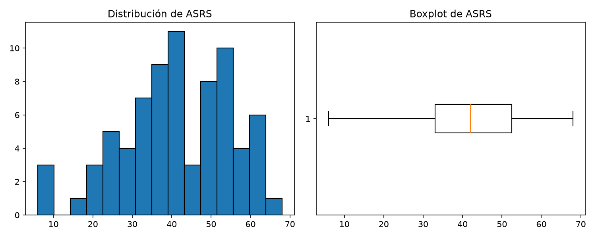
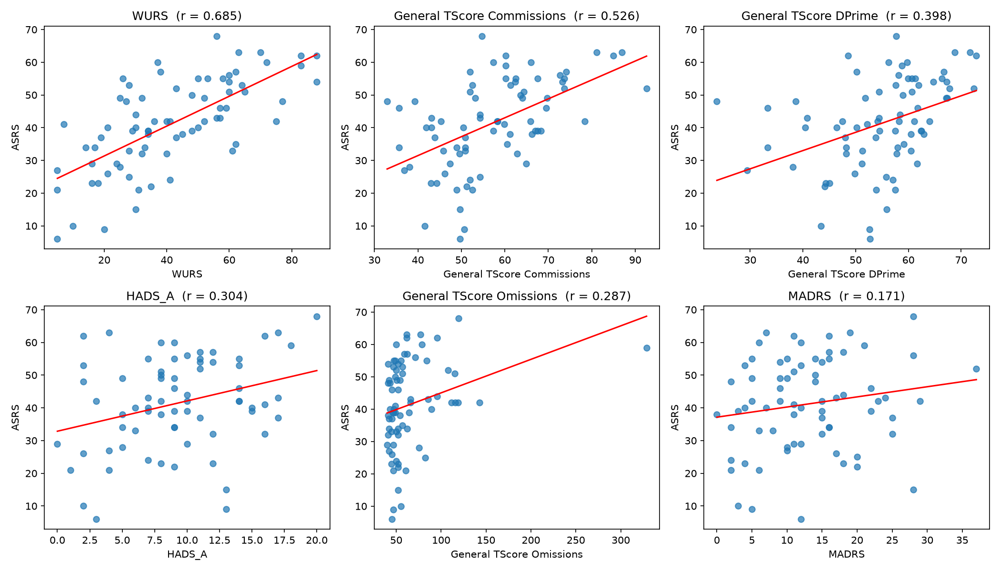

# 1. Introducción y planteamiento del problema

El Trastorno por Déficit de Atención e Hiperactividad (TDAH) es un trastorno del neurodesarrollo que comienza en la infancia y que, en muchos casos, continúa presente en la vida adulta. En los adultos se manifiesta principalmente como dificultad para mantener la atención, desorganización e impulsividad, y con frecuencia se presenta junto con otros problemas como la ansiedad o la depresión. Evaluarlo en esta etapa no es sencillo, ya que depende en gran medida de lo que el propio paciente reporta sobre sus síntomas actuales y de lo que recuerda de su infancia.

Para este proyecto utilizamos el conjunto de datos clínico HYPERAKTIV (Hicks et al., 2021), el cual reúne información de pacientes adultos que fueron evaluados por sospecha de TDAH. Esta base incluye escalas clínicas que los pacientes respondieron por sí mismos, datos demográficos y su desempeño en una prueba computarizada de atención conocida como CPT-II. Consideramos que antes de construir cualquier modelo es necesario comprender a fondo el contexto clínico del problema, por lo que una parte importante del trabajo consistió en entender qué mide cada variable y cómo se relaciona con el trastorno.

La pregunta que buscamos responder es en qué medida la severidad de los síntomas de TDAH en adultos, medida con la escala ASRS, puede explicarse a partir de los síntomas que el paciente tuvo en la infancia, de su desempeño en una prueba objetiva de atención e impulsividad y de su nivel de ansiedad.

Nuestro objetivo general es construir y evaluar un modelo de Regresión Lineal Múltiple estimado por Mínimos Cuadrados Ordinarios (MCO) que explique la puntuación ASRS a partir de estas variables, e interpretar sus resultados dentro del contexto clínico. Para lograrlo, primero exploramos gráficamente la variable respuesta y su relación con las variables candidatas; después cuantificamos esa relación con el coeficiente de correlación de Pearson ($r$) y seleccionamos los predictores cuidando que no existiera multicolinealidad. Posteriormente estimamos el modelo, interpretamos sus parámetros y evaluamos su significancia, y finalmente generamos estimaciones para perfiles clínicos representativos con el fin de valorar su utilidad práctica.

# 2. Justificación del método: regresión lineal múltiple

Elegimos la regresión lineal múltiple y no un modelo de series de tiempo porque nuestros datos son de corte transversal. Cada fila de la base corresponde a un paciente distinto que fue evaluado una sola vez, por lo que no existe un orden en el tiempo entre las observaciones ni mediciones repetidas de una misma persona, que es justamente lo que requiere una serie de tiempo. Además, nuestro interés no es pronosticar cómo evoluciona una variable con el paso del tiempo, sino entender cómo cambia la ASRS cuando cambian otras características del paciente.

Contamos con más de una variable independiente que muestra una relación lineal razonable con la respuesta, lo que justifica utilizar un modelo múltiple en lugar de uno simple. El tamaño de muestra también es suficiente, ya que la base integrada tiene $n = 75$ pacientes y la muestra efectiva del modelo, una vez eliminados los valores faltantes, es de $n = 69 \ge 30$. Como verificación posterior, el estadístico de Durbin-Watson de los residuales ($DW = 2.174$) no muestra autocorrelación, lo cual es consistente con tener observaciones independientes.

## 2.1 Metodología de trabajo

Organizamos el proyecto siguiendo el marco CRISP-DM / CRISP-ML(Q) (*Cross-Industry Standard Process for Machine Learning with Quality Assurance*), el cual divide el análisis en fases que se pueden repetir y revisar, con controles de calidad en cada una. Este enfoque nos permitió mantener el entorno reproducible, evitar fuga de información, validar los supuestos del modelo y llevar un registro de los cambios en Git. Cada fase quedó implementada en un notebook independiente:

| Fase CRISP-ML(Q) | Implementación en el proyecto |
|---|---|
| 1. Comprensión del problema y de los datos | Definición de ASRS como $Y$, revisión de las tres fuentes de HYPERAKTIV y EDA (notebooks 01 y 02) |
| 2. Preparación de los datos | Limpieza, integración por `ID`, exclusión de variables con fuga de información y selección de predictores con VIF (notebooks 01 y 02) |
| 3. Modelado | Planteamiento y estimación del modelo MCO en `statsmodels` (notebook 03) |
| 4. Evaluación y aseguramiento de calidad | Pruebas $F$ y $t$, $R^2$, gráfica real vs. predicho, diagnóstico de residuales y transformaciones (notebooks 03 y 04) |
| 5. Inferencia aplicada | Estimaciones puntuales e intervalos al 95 % para perfiles clínicos (notebook 04) |
| 6. Comunicación | Reporte final y exposición oral |

# 3. Descripción de las variables

## 3.1 Variable respuesta ($Y$): ASRS

La Adult ADHD Self-Report Scale (ASRS v1.1) es un cuestionario que el propio paciente responde y que fue desarrollado junto con la Organización Mundial de la Salud. Está formado por 18 preguntas basadas en los criterios del DSM, divididas entre síntomas de inatención y de hiperactividad e impulsividad. Cada pregunta se califica de 0 (*nunca*) a 4 (*muy frecuentemente*), por lo que la puntuación total va de 0 a 72, y entre más alto es el puntaje, mayor es la severidad de los síntomas. Es importante aclarar que la ASRS es un instrumento de cribado y no de diagnóstico, ya que un puntaje alto indica síntomas intensos, pero el diagnóstico lo realiza un profesional clínico.

## 3.2 Variables independientes ($X_j$)

| Variable | Instrumento | Qué mide | Escala | Interpretación |
|---|---|---|---|---|
| $X_1$: `WURS` | Wender Utah Rating Scale | Síntomas de TDAH en la infancia, reportados por el adulto de forma retrospectiva | 0–100 | Valores ≥ 46 se usan como punto de corte orientativo de TDAH en la infancia |
| $X_2$: `General TScore Commissions` | Conners' Continuous Performance Test II (CPT-II) | Errores de comisión: responder ante el estímulo en el que se debía detener la respuesta (impulsividad) | Puntuación T (media 50, DE 10) | T > 60 indica un desempeño elevado o atípico |
| $X_3$: `HADS_A` | Hospital Anxiety and Depression Scale, subescala de ansiedad | Síntomas de ansiedad | 0–21 | 0–7 normal, 8–10 limítrofe, ≥ 11 clínicamente significativa |

Estas tres variables nos permiten observar al paciente desde distintos enfoques: su historia clínica a través de WURS, su desempeño objetivo en una prueba de atención con el CPT-II y su estado emocional con HADS_A. Decidimos excluir como predictores el identificador (`ID`) y los diagnósticos `ADHD` y `ADD`, ya que representan el diagnóstico mismo y su inclusión generaría fuga de información.

# 4. Análisis exploratorio de datos (EDA) y correlación

## 4.1 Distribución de ASRS

La base integrada contiene $n = 75$ pacientes, cuyos puntajes de ASRS van de 6 a 68 puntos, con una media aproximada de 41.4, una mediana de 42 y una desviación estándar cercana a 13.9. La distribución es aproximadamente simétrica, aunque presenta una ligera cola hacia la izquierda debido a un pequeño grupo de tres pacientes con puntajes muy bajos, entre 6 y 10. El diagrama de caja no muestra valores atípicos, y la cercanía entre la media y la mediana indica que no existe un sesgo fuerte que nos obligue a transformar $Y$ desde el inicio.

## 4.2 Coeficientes de correlación de Pearson

Calculamos el coeficiente $r$ de cada variable candidata numérica con ASRS, junto con su $p$-valor. La tabla completa se encuentra en `reports/tables/correlaciones_asrs.csv`, y las principales se muestran a continuación:

| Variable | $r$ | $p$-valor | Interpretación |
|---|---|---|---|
| WURS | 0.685 | < 0.001 | Positiva fuerte, significativa |
| General TScore Commissions | 0.526 | < 0.001 | Positiva moderada, significativa |
| General TScore DPrime | 0.398 | < 0.001 | Positiva moderada, significativa |
| HADS_A | 0.304 | 0.011 | Positiva débil a moderada, significativa |
| General TScore Omissions | 0.287 | 0.013 | Positiva débil (inflada por un punto influyente) |
| MADRS | 0.171 | 0.154 | No significativa |
| HADS_D | 0.112 | 0.361 | No significativa |
| AGE | −0.116 | 0.320 | No significativa |

WURS es la variable con la asociación más fuerte, lo que significa que los pacientes que reportan más síntomas de TDAH en su infancia tienden también a reportar mayor severidad en la adultez. Este resultado es coherente con la naturaleza del TDAH, ya que se trata de un trastorno del neurodesarrollo que comienza en la infancia. Commissions también se asocia de forma positiva con ASRS, es decir, cometer más errores de impulsividad en una prueba objetiva se relaciona con una mayor severidad reportada por el paciente. Esta relación nos parece especialmente relevante porque conecta una medida conductual con una de autorreporte. Por su parte, HADS_A presenta una asociación débil pero significativa, lo cual concuerda con la frecuencia con la que el TDAH y la ansiedad se presentan juntos. En cambio, MADRS, HADS_D y la edad no muestran una relación lineal significativa con ASRS.

Cabe mencionar que las versiones *Adhd*, *General* y *Neuro* de las puntuaciones T del CPT-II corresponden a la misma medida comparada contra distintos grupos de referencia, por lo que decidimos utilizar únicamente la versión *General*.

## 4.3 Gráficas de dispersión

En la gráfica de WURS se observa una relación claramente lineal y positiva, con una dispersión pareja a lo largo de todo el eje, sin forma de embudo. Commissions también muestra una tendencia lineal positiva, aunque con mayor dispersión que WURS, y DPrime sigue un patrón similar, pero todavía más disperso. En el caso de HADS_A, la relación es débil y la nube de puntos es muy dispersa, con una pendiente leve. MADRS no muestra ninguna tendencia, por lo que la incluimos como ejemplo de una variable sin relación lineal con ASRS.

Omissions merece una mención especial. La mayoría de sus valores se concentra entre 40 y 100, pero un solo paciente con un valor cercano a 330 jala la recta de tendencia hacia arriba. Esto significa que su correlación ($r = 0.287$) está inflada por ese único punto influyente, por lo que decidimos descartarla. Este caso nos mostró por qué el coeficiente $r$ siempre debe acompañarse de una revisión gráfica, ya que un solo valor extremo puede generar una correlación que en realidad no existe.

## 4.4 Selección de predictores

Al revisar la matriz de correlación entre las variables candidatas, encontramos que Commissions y DPrime tienen una correlación de $r = 0.88$ entre sí, lo que indica que miden prácticamente lo mismo y que incluir ambas en el modelo generaría multicolinealidad. Por esta razón conservamos únicamente Commissions, ya que su correlación con ASRS es mayor. El resto de las combinaciones presentó valores de $|r| \le 0.47$.

Finalmente, seleccionamos como predictores WURS, General TScore Commissions y HADS_A. El Factor de Inflación de Varianza confirmó que no existe multicolinealidad entre ellos, ya que todos sus valores quedaron muy por debajo del umbral de 5 (WURS = 1.623, Commissions = 1.390 y HADS_A = 1.205).

# 5. Interpretación clínica de los parámetros

El modelo estimado con $n = 69$ pacientes es el siguiente:

$$\widehat{\text{ASRS}}_i = 7.635 + 0.368\,\text{WURS}_i + 0.308\,\text{Commissions}_i + 0.127\,\text{HADS\_A}_i$$

El intercepto ($\hat{\beta}_0 = 7.635$, $p = 0.216$) representa el valor esperado de ASRS cuando las tres variables valen cero. Sin embargo, este valor no tiene una interpretación clínica, ya que una puntuación T de Commissions igual a cero es imposible (el mínimo observado es de aproximadamente 33). Su función es únicamente matemática, para ubicar el plano de regresión, y además no resulta estadísticamente distinto de cero.

El coeficiente de WURS ($\hat{\beta}_1 = 0.368$, $p < 0.001$, IC 95 % [0.221, 0.515]) indica que por cada punto adicional en esta escala, la ASRS esperada aumenta 0.37 puntos, manteniendo constantes Commissions y HADS_A. En términos prácticos, 10 puntos más de síntomas en la infancia se asocian con aproximadamente 3.7 puntos más de severidad en la adultez. Se trata del predictor más importante del modelo, y su efecto respalda la idea de que el TDAH tiene continuidad desde la infancia hasta la vida adulta.

El coeficiente de Commissions ($\hat{\beta}_2 = 0.308$, $p = 0.010$, IC 95 % [0.076, 0.540]) indica que por cada punto T adicional en errores de comisión, la ASRS esperada aumenta 0.31 puntos, manteniendo constantes las demás variables. Esto quiere decir que una desviación estándar más de impulsividad en el CPT-II, equivalente a 10 puntos T, se relaciona con aproximadamente 3.1 puntos más de ASRS. Este resultado nos parece valioso, ya que muestra que una medida conductual objetiva aporta información adicional a la que ya ofrece el reporte de síntomas en la infancia.

En el caso de HADS_A ($\hat{\beta}_3 = 0.127$, $p = 0.655$, IC 95 % [−0.439, 0.693]), el coeficiente es positivo pero no significativo, y su intervalo de confianza incluye el cero. Aunque la ansiedad sí se relacionaba con ASRS cuando la analizamos por sí sola ($r = 0.304$), esa relación desaparece al controlar por WURS y Commissions. Consideramos que esto se explica porque HADS_A comparte información con WURS ($r = 0.41$), es decir, parte de la ansiedad observada acompaña a la historia de TDAH del paciente, en lugar de explicar por sí misma la severidad actual de los síntomas.

En cuanto a la bondad de ajuste, el modelo explica el 53.4 % de la variación de ASRS ($R^2 = 0.534$, $R^2_{\text{ajustado}} = 0.513$). La prueba $F$ global resultó altamente significativa ($F(3, 65) = 24.84$, $p < 0.001$), por lo que al menos uno de los predictores aporta información sobre la ASRS. Cerca del 47 % de la variación queda sin explicar, lo cual es esperable tratándose de un fenómeno clínico en el que intervienen muchos factores.

---

> **Pendiente (cuando Richie suba el Notebook 04):** sección de transformaciones (justificación de transformar o conservar el modelo base), estimaciones puntuales para los perfiles de carga baja, moderada y alta, conclusión de utilidad clínica y conclusiones generales.

# Referencias

- Hicks, S. A., Stautland, A., Fasmer, O. B., Førland, W., Hammer, H. L., Halvorsen, P., … Riegler, M. A. (2021). HYPERAKTIV: An activity dataset from patients with attention-deficit/hyperactivity disorder (ADHD). *Proceedings of the 12th ACM Multimedia Systems Conference*.
- Kessler, R. C., Adler, L., Ames, M., et al. (2005). The World Health Organization Adult ADHD Self-Report Scale (ASRS). *Psychological Medicine, 35*(2), 245–256.
- Ward, M. F., Wender, P. H., & Reimherr, F. W. (1993). The Wender Utah Rating Scale: An aid in the retrospective diagnosis of childhood attention deficit hyperactivity disorder. *American Journal of Psychiatry, 150*(6), 885–890.
- Zigmond, A. S., & Snaith, R. P. (1983). The Hospital Anxiety and Depression Scale. *Acta Psychiatrica Scandinavica, 67*(6), 361–370.
- Conners, C. K. (2000). *Conners' Continuous Performance Test II (CPT II)*. Multi-Health Systems.
