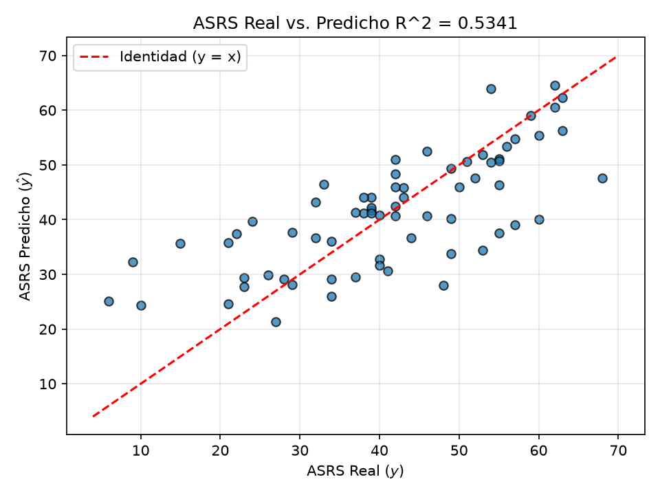
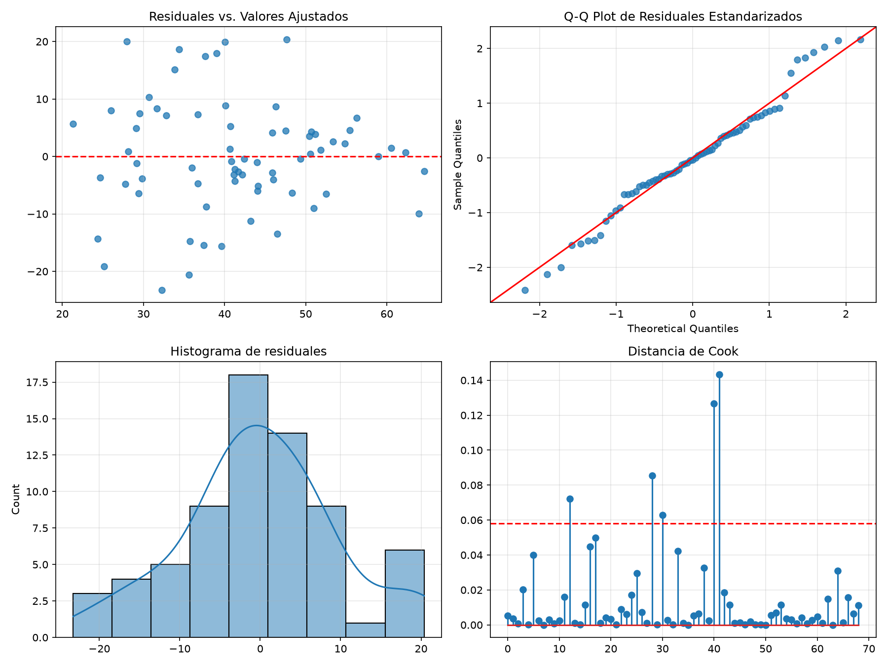
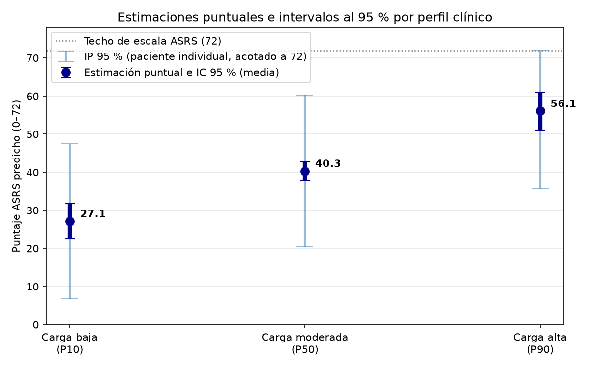

> **Nota para ensamblaje editorial (Mariana):** Estas secciones técnicas están redactadas en Obsidian Markdown con rutas relativas `../figures/` y el mismo formato matemático/tablas que `secciones_mariana.md`, listas para integrarse directamente en el reporte final (Obsidian $\rightarrow$ LaTeX/PDF).

---

# A. Ingeniería de datos: limpieza e integración del dataset HYPERAKTIV

El conjunto de datos **HYPERAKTIV** (Hicks et al., 2021) se distribuye originalmente en tres archivos independientes delimitados por punto y coma (`sep=";"`):

1. `patient_info.csv`: variables demográficas, escalas clínicas autorreportadas (`ASRS`, `WURS`, `MADRS`, `HADS_A`, `HADS_D`) y diagnósticos psiquiátricos.
2. `features.csv`: características estadísticas y espectrales derivadas de actigrafía y variabilidad de frecuencia cardiaca (HRV).
3. `CPT_II_ConnersContinuousPerformanceTest.csv` (codificación `utf-8-sig`): métricas objetivas de atención sostenida e impulsividad provenientes de la prueba computarizada CPT-II.

En el cuaderno `notebooks/01_data_ingestion_and_cleaning.ipynb` se ejecutó un flujo reproducible de preparación y auditoría de calidad con los siguientes controles:

- **Integración por identificador único (`ID`):** se verificó la ausencia de duplicados por paciente y se realizó un *inner join* entre las tres fuentes.
- **Control de calidad en CPT-II:** se aplicó la regla clínica `Raw Score Omissions < 300` para descartar sesiones inválidas en las que el paciente no respondió o se presentó desconexión del dispositivo de entrada.
- **Filtrado de la variable respuesta y depuración estructural:** se eliminaron observaciones sin puntaje registrado en `ASRS` y se excluyeron columnas de detalle individual por ensayo para conservar únicamente métricas agregadas y clínicamente interpretables.
- **Prevención de fuga de información (*data leakage*):** se excluyeron explícitamente de la lista de predictores candidatos tanto el identificador `ID` como los diagnósticos binarios directos (`ADHD`, `ADD`).

Como resultado se obtuvo el dataset integrado `data/processed/hyperaktiv_arc_clean.csv` con **$n = 75$ pacientes y 885 columnas** (`ASRS`: media $= 41.39$, desviación estándar $= 13.90$, rango $= [6.0, 68.0]$). Al restringir el análisis a casos completos en la variable objetivo y los tres predictores seleccionados (`WURS`, `General TScore Commissions` y `HADS_A`), se identificaron 1 valor faltante en `WURS` y 6 en `HADS_A` (0 en `ASRS` y `Commissions`), conformando una **muestra efectiva de $n = 69$ observaciones** ($n \ge 30$).

---

# B. Validación de multicolinealidad mediante el Factor de Inflación de Varianza (VIF)

Para garantizar la estabilidad numérica de los estimadores de Mínimos Cuadrados Ordinarios (MCO) y evitar varianzas infladas en los coeficientes, se evaluó la colinealidad lineal entre los predictores seleccionados en `notebooks/02_eda_and_feature_selection.ipynb`.

El **Factor de Inflación de Varianza** para el $j$-ésimo regresor se define como:

$$\text{VIF}_j = \frac{1}{1 - R_j^2}$$

donde $R_j^2$ es el coeficiente de determinación obtenido al regresar el predictor $X_j$ contra el resto de los predictores del modelo (incluyendo el término constante). Se adoptó el criterio estándar $\text{VIF}_j < 5$ (con valores ideales $< 2$). Los resultados oficiales (`reports/tables/ols_vif.csv`) se presentan a continuación:

| Predictor ($X_j$) | VIF | Evaluación ($\text{VIF} < 5$) |
|---|---:|---|
| `WURS` | `1.623` | Cumple (sin multicolinealidad) |
| `General TScore Commissions` | `1.390` | Cumple (sin multicolinealidad) |
| `HADS_A` | `1.205` | Cumple (sin multicolinealidad) |

Todos los predictores presentan $\text{VIF} < 2$, confirmando que aportan información linealmente independiente y que la matriz de diseño $\mathbf{X}$ está bien condicionada para la estimación por MCO.

---

# C. Desarrollo matemático del modelo MCO y evaluación estadística

## C.1 Formulación escalar y matricial (Rúbrica 2a)

El modelo de Regresión Lineal Múltiple poblacional que relaciona la severidad de síntomas de TDAH en adultos (`ASRS`) con los tres predictores confirmados se expresa en forma escalar como:

$$\text{ASRS}_i = \beta_0 + \beta_1\,\text{WURS}_i + \beta_2\,\text{Commissions}_i + \beta_3\,\text{HADS\_A}_i + \varepsilon_i, \quad i = 1, \dots, 69$$

donde $\varepsilon_i$ denota el término de error aleatorio bajo los supuestos clásicos de Gauss-Markov y normalidad: $\mathbb{E}[\varepsilon_i \mid \mathbf{X}] = 0$, $\text{Var}(\varepsilon_i \mid \mathbf{X}) = \sigma^2$, $\text{Cov}(\varepsilon_i, \varepsilon_j \mid \mathbf{X}) = 0$ para $i \neq j$, y $\varepsilon_i \sim \mathcal{N}(0, \sigma^2)$.

En notación matricial:

$$\mathbf{y} = \mathbf{X}\boldsymbol{\beta} + \boldsymbol{\varepsilon}$$

con $\mathbf{y} \in \mathbb{R}^{69 \times 1}$, matriz de diseño $\mathbf{X} \in \mathbb{R}^{69 \times 4}$ (primera columna de unos para el intercepto) y vector de parámetros $\boldsymbol{\beta} = [\beta_0, \beta_1, \beta_2, \beta_3]^\top$. El estimador de **Mínimos Cuadrados Ordinarios (MCO)** minimiza la suma de cuadrados residual $S(\boldsymbol{\beta}) = (\mathbf{y} - \mathbf{X}\boldsymbol{\beta})^\top(\mathbf{y} - \mathbf{X}\boldsymbol{\beta})$ y tiene solución cerrada:

$$\hat{\boldsymbol{\beta}} = (\mathbf{X}^\top \mathbf{X})^{-1}\mathbf{X}^\top \mathbf{y}$$

Sustituyendo los parámetros estimados en `notebooks/03_ols_modeling_and_diagnostics.ipynb`, la ecuación de regresión estimada es:

$$\widehat{\text{ASRS}}_i = 7.6350 + 0.3678\,\text{WURS}_i + 0.3079\,\text{Commissions}_i + 0.1273\,\text{HADS\_A}_i$$

## C.2 Tabla de coeficientes, pruebas $t$ e intervalos de confianza (Rúbrica 4b)

La Tabla siguiente resume los estimadores MCO, errores estándar, estadísticos $t$ ($gl = n - k - 1 = 65$), $p$-valores e intervalos de confianza al 95 % (`reports/tables/ols_coefficients.csv`):

| Término | Coeficiente ($\hat{\beta}_j$) | Error Estándar ($EE$) | Estadístico $t$ | $p$-valor | IC 95 % Inferior | IC 95 % Superior | Significancia ($\alpha = 0.05$) |
|---|---:|---:|---:|---:|---:|---:|---|
| `const` ($\hat{\beta}_0$) | `7.6350` | `6.1095` | `1.2497` | `0.2159` | `-4.5666` | `19.8365` | No significativo |
| `WURS` ($\hat{\beta}_1$) | `0.3678` | `0.0736` | `4.9957` | `< 0.0001` | `0.2208` | `0.5149` | Significativo ($p < 0.001$) |
| `General TScore Commissions` ($\hat{\beta}_2$) | `0.3079` | `0.1162` | `2.6507` | `0.0101` | `0.0759` | `0.5399` | Significativo ($p < 0.05$) |
| `HADS_A` ($\hat{\beta}_3$) | `0.1273` | `0.2833` | `0.4492` | `0.6547` | `-0.4385` | `0.6931` | No significativo |

## C.3 Bondad de ajuste y prueba de significancia global $F$ (Rúbrica 4a y 4b)

Las métricas globales del ajuste (`reports/tables/ols_summary_metrics.csv`) se resumen a continuación:

| Métrica | Valor | Interpretación técnica |
|---|---:|---|
| Observaciones ($n$) | `69` | Casos completos ($gl_{\text{modelo}} = 3$, $gl_{\text{residual}} = 65$) |
| $R^2$ | `0.5341` | El modelo explica el 53.41 % de la varianza total de `ASRS` |
| $R^2_{\text{ajustado}}$ | `0.5126` | 51.26 % de varianza explicada penalizando por $k = 3$ predictores |
| Estadístico $F(3, 65)$ | `24.8355` | Contrasta $H_0: \beta_1 = \beta_2 = \beta_3 = 0$ |
| $p$-valor ($F$) | `8.00e-11` | Se rechaza $H_0$ ($p < 0.001$); modelo globalmente significativo |
| $\text{RMSE}$ (error estándar residual) | `9.9015` | Magnitud típica del error residual en puntos `ASRS` (escala 0–72) |
| AIC / BIC | `516.08` / `525.02` | Criterios de información para comparación de especificaciones |

## C.4 Evaluación visual: valores reales vs. predichos (Rúbrica 4c)

Los puntos se distribuyen de manera consistente alrededor de la recta identidad ($y = x$), sin curvaturas sistemáticas. Como es propio de un ajuste lineal con $R^2 = 0.5341$ y $\text{RMSE} = 9.9015$, las predicciones muestran una ligera regresión hacia la media en los extremos (leve sobreestimación para $y < 15$ y leve subestimación cerca del límite superior $y > 60$).

---

# D. Diagnóstico de supuestos clásicos sobre los residuales

Para validar la inferencia estadística (pruebas $t$, prueba $F$ e intervalos de confianza/predicción) se realizó un diagnóstico gráfico y formal de los residuales $e_i = y_i - \hat{y}_i$ en `notebooks/03_ols_modeling_and_diagnostics.ipynb`.

Los resultados de las pruebas formales (`reports/tables/ols_diagnostics.csv` y resumen OLS) se concentran en la siguiente tabla:

| Supuesto evaluado | Prueba / Indicador | Estadístico | $p$-valor / Umbral | Conclusión ($\alpha = 0.05$) |
|---|---|---:|---:|---|
| Normalidad de residuales | Shapiro-Wilk ($W$) | `0.9780` | `p = 0.2634` | **Cumple** ($p > 0.05$; Omnibus $p = 0.885$, JB $p = 0.991$) |
| Homocedasticidad | Breusch-Pagan ($\text{LM}$ / $F$) | `6.7705` / `2.3573` | `p = 0.0796` / `0.0798` | **Cumple al 5 %** ($p > 0.05$, cercano al umbral) |
| Independencia de errores | Durbin-Watson ($\text{DW}$) | `2.174` | Referencia $\approx 2.0$ | **Cumple** (sin autocorrelación residual) |
| Puntos influyentes | Distancia de Cook ($D_i$) | 5 casos $> 4/n$ (`0.058`) | **0 casos $> 1.0$** | **Estable** (sin observaciones patológicas) |

En el panel diagnóstico: (i) el gráfico de residuales vs. ajustados muestra dispersión aleatoria alrededor de cero sin patrón curvo; (ii) el Q-Q plot de residuales estandarizados y el histograma confirman simetría y normalidad; y (iii) ninguna observación supera el umbral crítico $D_i > 1.0$.

---

# E. Evaluación de transformaciones y reversión a la escala original (Rúbrica 3a)

Aunque el modelo lineal base cumple todos los supuestos al nivel $\alpha = 0.05$, el $p$-valor marginal de Breusch-Pagan ($p = 0.0796$) y la no significancia individual de `HADS_A` ($p = 0.6547$) motivaron evaluar en `notebooks/04_transformations_and_forecasting.ipynb` tres especificaciones alternativas sobre la misma muestra ($n = 69$):

1. **Modelo Log-Lineal ($\ln(\text{ASRS})$):** se ajusta $\ln(Y_i) = \mathbf{x}_i^\top \boldsymbol{\gamma} + u_i$. Para regresar a la escala original de `ASRS` sin sesgo de retransformación (corrección log-normal / Duan), se aplica la fórmula de reversión:
   $$\widehat{\text{ASRS}}_i = \exp\!\left(\widehat{\ln Y}_i + \frac{\hat{\sigma}_u^2}{2}\right)$$
2. **Modelo Raíz Cuadrada ($\sqrt{\text{ASRS}}$):** se ajusta $\sqrt{Y_i} = \mathbf{x}_i^\top \boldsymbol{\delta} + v_i$, cuya reversión a la escala original es:
   $$\widehat{\text{ASRS}}_i = \left(\widehat{\sqrt{Y}}_i\right)^2 + \hat{\sigma}_v^2$$
3. **Modelo Parsimonioso (lineal sin `HADS_A`):** conserva únicamente `WURS` y `General TScore Commissions` ($k = 2$).

La tabla comparativa (`reports/tables/ols_transformations_comparison.csv`) evalúa todos los modelos con **RMSE y $R^2$ comparables en la escala original de `ASRS`**:

| Modelo | $k$ | $R^2_{\text{adj}}$ (escala modelo) | $R^2$ (escala `ASRS`) | RMSE (escala `ASRS`) | AIC | BIC | Shapiro-Wilk ($p$) | Breusch-Pagan ($p$) |
|---|---:|---:|---:|---:|---:|---:|---:|---:|
| **Base lineal (3 pred.)** | 3 | `0.5126` | **`0.5341`** | **`9.6102`** | `516.08` | `525.02` | **`0.2634`** | **`0.0796`** |
| Log-Lineal $\ln(\text{ASRS})$ | 3 | `0.4030` | `0.4427` | `10.5101` | `57.93`\* | `66.87`\* | `0.0000` | `0.0268` |
| Raíz cuadrada $\sqrt{\text{ASRS}}$ | 3 | `0.4726` | `0.5228` | `9.7259` | `183.79`\* | `192.73`\* | `0.0127` | `0.0215` |
| Parsimonioso (sin `HADS_A`) | 2 | `0.5185` | `0.5326` | `9.6251` | `514.30` | `521.00` | `0.2829` | `0.0411` |

*\*Nota técnica: AIC y BIC no son directamente comparables entre modelos con distinta transformación de $Y$ (cambia la escala de la verosimilitud); la comparación válida entre escalas distintas se realiza mediante el RMSE y $R^2$ revertidos a la escala original de `ASRS`.*

**Justificación técnica de la selección:**
- Las transformaciones cóncavas ($\ln$ y $\sqrt{\cdot}$) están diseñadas para corregir asimetría positiva (cola derecha). Como `ASRS` exhibe una ligera cola izquierda (tres puntajes entre 6 y 10), estas transformaciones estiran la cola inferior, **rompen la normalidad** ($p < 0.0001$ y $p = 0.0127$), **empeoran la homocedasticidad** ($p = 0.0268$ y $p = 0.0215$) e **incrementan el error** en escala original ($\text{RMSE} = 10.5101$ y $9.7259$ frente a $9.6102$).
- El modelo parsimonioso sin `HADS_A` incrementa ligeramente $R^2_{\text{adj}}$ (`0.5185`), pero **incumple homocedasticidad** al 5 % (Breusch-Pagan $p = 0.0411 < 0.05$).
- Por tanto, se **conserva el modelo lineal base (3 predictores) en escala original** como modelo final, al ser la única especificación que satisface simultáneamente todos los supuestos clásicos, logra el menor RMSE en puntos `ASRS` y mantiene el control clínico de ansiedad.

---

# F. Estimaciones puntuales e intervalos al 95 % para perfiles clínicos (Rúbrica 5a)

Utilizando el modelo lineal base final y el método `.get_prediction().summary_frame(alpha=0.05)` de `statsmodels`, se calcularon las estimaciones puntuales $\widehat{\text{ASRS}}$, el **intervalo de confianza al 95 % para la media poblacional** (IC 95 %) y el **intervalo de predicción al 95 % para un paciente individual** (IP 95 %) sobre los tres perfiles definidos mediante los percentiles P10, P50 y P90 de la muestra efectiva ($n = 69$, sin extrapolación). Como verificación de consistencia, se incluye también la estimación revertida del modelo $\sqrt{\text{ASRS}}$ (`reports/tables/ols_forecasts.csv`):

| Perfil clínico | `WURS` | `Commissions` ($T$) | `HADS_A` | $\widehat{\text{ASRS}}$ (Base) | IC 95 % (media) | IP 95 % (individual) | IP 95 % acotado (0–72) | $\widehat{\text{ASRS}}$ ($\sqrt{Y}$ revertido) |
|---|---:|---:|---:|---:|---|---|---|---:|
| **Carga baja (P10)** | 16 | 43 | 3 | **`27.14`** | `[22.48, 31.81]` | `[6.82, 47.46]` | `[6.82, 47.46]` | `27.09` |
| **Carga moderada (P50)** | 38 | 57 | 9 | **`40.31`** | `[37.90, 42.72]` | `[20.39, 60.23]` | `[20.39, 60.23]` | `39.54` |
| **Carga alta (P90)** | 65 | 73 | 16 | **`56.06`** | `[51.11, 61.00]` | `[35.67, 76.44]` | `[35.67, 72.00]` | `57.62` |

Los resultados evidencian una separación estadísticamente clara entre perfiles (brecha de **28.92 puntos** entre carga baja y alta, con intervalos de confianza de la media totalmente disjuntos), mientras que la amplitud de los intervalos de predicción individuales ($\approx \pm 20$ puntos, coherente con $\text{RMSE} = 9.9015$) cuantifica con precisión la incertidumbre remanente a nivel de paciente individual y fundamenta su uso como herramienta de apoyo al cribado más que como sustituto diagnóstico.

